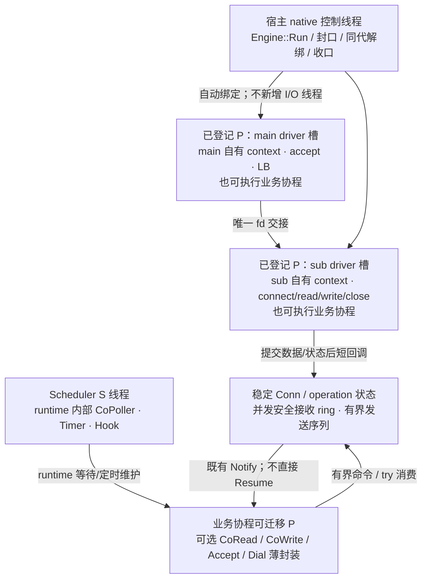

# gnet 风格网络：执行域、物理线程与所有权

**状态：R2 TCP 核心契约已获用户确认；本文对齐目标设计，不代表新接口已实现或两仓联调已通过。** 机制与公开边界见 [0010](../decisions/0010-gnet-network-foundation.md)，实施接续见 [迁移计划](../plans/gnet-network-migration.md)。旧线程、事件快照及局部验证记录在文末历史区保留，不作为 R2 的实施约束或新版本验收证据。

## 1. 决定与适用范围

infra net 提供稳定可靠、并发安全、有界的 TCP 字节收发，尽可能报告可确认的接纳、进度、本地完成、EOF 和错误。这里的可靠不等于网络永不失败、数据必达或对端业务必执行。

- coroutine 继续负责 Scheduler、Processer、有栈协程，以及内部等待、Timer、Hook、CoPoller 和对象安全；进程寿命、单次初始化、无 Stop/restart 不变。
- infra 自有 main/sub Asio context、listener、socket、连接、缓冲与物理收口；每个 Reactor 绑定一个已登记 Processer driver 槽，不另建网络 I/O 线程。
- 原始入口为异步操作与短回调；协程同步接口是复用 CoWaiter/Chan 等原语的可选薄封装，不另建网络内核。
- 上层负责分帧、请求匹配、等待业务回包、重试、避让、重连及业务关闭策略。net 不因普通等待超时、读 EOF 或写错误自动关闭连接或重发。
- 本次设计覆盖完整 TCP server/client；不包含 HTTP/RPC 接入、消费者迁移、UDP/TLS、动态 owner 迁移或自愈平台。旧模块与原语保留，不因设计确认变成已迁移。
- 依赖保持 `bbt-framework → bbtools-infra → bbtools-coroutine`；不向 coroutine 下沉网络类型、缓冲或业务策略。

## 2. 目标线程拓扑

默认 THREAD 模式仍由 S 线程推进 runtime 内部 EventLoop。P 线程交替执行业务协程与非业务协程边界的 driver；业务协程可迁移 P，连接 I/O owner 固定。



| 角色 | 驱动与责任 | 边界 |
|---|---|---|
| main Reactor | server 普通布局的 listener、accept、LB、fd 唯一交接 | 一个已登记 P 的 driver 槽；不执行业务等待 |
| sub Reactor | 归属连接的 native I/O、注册/撤销、物理 close、自有 context | 各占一个 P 槽；同连接 owner 固定；非阻塞推进有预算 |
| Processer | 在 worker 线程调度业务协程并推进绑定 driver | 不给业务协程提供永久 P/CPU 亲和或实时性保证 |
| Engine::Run | 调用它的非受管、非 owner native 线程上的启动、控制与收口 | 不暗中创建控制线程或第二 I/O driver |
| Conn/operation | 共享数据与持久状态、数据所有权、有界接纳和完成责任 | 不暴露 Asio 对象，不将 shared_ptr 当作对象同步 |

server 普通布局保留一个 main 加 N 个 sub，配置 N 表示 sub 数，启动必须报告包含 main 的实际槽需求。client-only 不创建 accept owner，不通过 ServerEngine 模拟 client。ReusePort、UDP 等旧目标不自动加入本次 TCP 实施范围。

Engine 自动枚举并绑定空闲已登记 P；查询空槽不是预留，以注册成功的同代 token 为准。槽不足或竞争失败回滚本次绑定，不抢占、不扩 worker、不静默缩数量、不退回独立网络线程。

### runtime 推进前提

宿主必须在启动配置中明确声明：runtime 内部 EventLoop 由独立于 Run 的执行流持续推进。THREAD 使用已有 S 线程；SCHE_LOOP 的 Start 在另一 native 线程运行；NO_LOOP 由另一执行流持续 LoopOnce。未初始化或未声明/声明不独立，Run 在绑定或建 socket 前明确拒绝；目标错误口径分别为 RuntimeNotInitialized / RuntimeProgressRequired，不表示这些 net 错误名已存在于头文件。

现有 Scheduler 提供 IsInitialized 和 driver 查询，但没有公开的启动模式/驱动线程存活探测。声明是宿主须履行的前提，不伪称库能证明另一线程持续进展；宿主停止推进后不能承诺协程 deadline 正常兑现。不得后台驱动与手动 tick 同时推进同一 runtime context。

## 3. Asio 与 gnet 的复用边界

`io::GetExecutor()` 仍属于 runtime 内部共享 context，不额外 run/poll/stop/restart，不注册到 infra driver。net 只由绑定 owner 推进自己的 context；解绑后的清理接管另见第 6 节。现有 HTTP/Redis/Mongo/config 等路径不因此迁移。

gnet v2.10.0 是接纳交接、owner、读写泵、缓冲及公平性的参考，不是必须逐方法兼容的模板。其 OnTraffic 在 eventloop 栈直接执行；本方案区分 owner 短原始回调与上层可挂起业务协程，不将 goroutine 当固定 OS 线程。

复用已有 Address、NativeSocket、LoadBalancer、EventRingBuffer、OutboundQueue 和部分读写机制，只补实际缺口。EventRingBuffer 当前是单 owner、非线程安全；需要最小同步访问面，不能直接宣称已有类可跨线程使用。OutboundQueue 合并字节不保留公共操作身份，须补有界记账，不能因此重造通用 Future 平台。

LT/ET 是读泵策略：有预算读取、EAGAIN、续投和高水位恢复由 adapter 兑现。Asio async_wait 不等价 native per-fd EPOLLET；外层 poll_one 数量不约束单 callback 耗时。Wake 必须 noexcept、线程安全、有界、持久记忆早到通知，不能单靠可能分配的 post 假定满足。

## 4. 跨域调用与完成时序

原始 API 名称表达目标职责，不是已交付头文件签名：

| 入口/出口 | 目标语义 |
|---|---|
| OnAccept / OnConnect | 交付稳定连接句柄或明确建连失败；net 不自动创建每连接业务协程 |
| AsyncWrite | 取得不可变数据所有权，全量接纳或零接纳；成功只表示承担发送责任，返回可查询的操作身份 |
| OnWrite | 报真实交内核进度和唯一终态；非终态进度须可区分，不承诺对端收到/执行 |
| OnRead | 只是通知，提示复查同一接收 ring 与持久读状态；可合并，不是包数或数据快照 |
| ReadStatus / WriteStatus / Status | EOF、错误、关闭与操作身份持久可查，通知合并或已发生后仍可观察 |
| RequestClose / OnClose | 显式封该连接并提交物理收口；关闭后通知，不把普通 fd 错误自动解释成该策略 |

同连接接纳次序定义发送次序，一次 AsyncWrite 的字节连续；部分写不插入别的操作字节，多次调用不自动组成业务帧。字节、操作数、命令、在途数据和通知责任统一有界计账，接纳后不能因第二层排队满而丢失完成。

容量满立即明确拒绝且零接纳；CoWrite 可无限或带绝对 deadline 等容量/本地完成，等待名额同样有界。容量等待超时=未提交；已接纳后的等待超时/取消仅结束等待，返回操作身份、采样进度及仍在途标记，owner 继续持有和推进，最终状态可查。采样不是冻结前缀，不可据此自动重发后缀。等待业务回包始终归上层。

真实写错误结算当前操作已发前缀与本轮后续未发操作；结算期间明确拒绝新写，不能跳过失败前缀继续旧队列。结算完且未关闭时允许新的 AsyncWrite，该调用本身表示上层新尝试；不续发旧操作，最近错误持久保留。关闭与结算同序仲裁，错误结算不能重开关闭状态。

CoWaiter 使用现有登记、复查、投递与 Notify 仲裁，登记失败不留下孤儿责任；完成/超时/取消竞争只产生一次等待结果，不等于底层操作已取消。Notify 在所有外层锁之外执行，不直接 Resume、不缓存协程创建线程/TLS。

## 5. Handler、数据与执行上下文

### 原始回调与业务协程

原始 OnAccept/OnConnect/OnRead/OnWrite/OnClose 在 Reactor owner P 的非业务协程边界执行，短、非阻塞、不可挂起。同连接不重入，不递归触发用户回调；不同 owner 可并发调用共享 handler。回调和 Notify 前释放内部保护；上层自行将业务转发到协程，业务协程可迁移，不自动为每次 readiness 建任务。

### 接收 ring 是唯一真源

- 复用已有 ring 的存储与游标，补最小并发访问；Co 不另建权威收包队列。
- 普通 TryRead 原子地复制并消费；多读者只保证各取线性化前缀，不匹配业务请求。竞争返回 Busy、零消费；空且无终态返回 WouldBlock。所有公开 ring 访问入口 try 获取保护，不让回调/owner 等 OS mutex。
- Peek 与 Consume 必须处在同一次短保护内；不能持保护挂起、调用未知代码或将裸 view 带出。长期持有数据用自有拷贝。
- owner 竞争失败延后；保护释放使用持久重试谓词、先登记再复查，覆盖先释放后登记交错。raw OnRead 遇 Busy 后合并补通知，不在当前栈递归、不依赖未来新字节。CoRead 可挂起等释放，不 spin。
- 先预留容量再非阻塞读取，临时未提交字节也算入上限；复制失败不前移消费游标。满则暂停读取，不覆盖未消费数据；消费后持久唤醒并主动复查，不依赖下一次边沿。
- 先发布数据/持久读状态，再 OnRead；仅有旧未消费数据不空转通知。EOF/错误即使无新增字节也须可观察。

EOF 只终结读取方向，不自动关闭发送侧。尾部仍可消费，耗尽后读返回 EOF；读错误同时保留已收数据与错误观察面。显式连接关闭或 Engine 收口后，已收数据仍可读，剩余 Conn/ring 的寿命不依赖 socket/context；不把缓冲内字节当成已分帧业务包。

CoAccept 只是 OnAccept 的有界交接封装：先预留容量再 native accept，满则暂停接纳，不无限生成协程或漏 fd；单个等待超时不误关供其它等待者取得的连接。CoDial 等待结束且无接收者的未交付 socket 由 owner 回收，这是资源回滚，不是对已交付连接的自动关闭策略。

## 6. 网络关闭，不是 runtime 停机

Engine::Run 占合法宿主 native 线程：校验前提→自动绑定→安装网络资源→发布 Running→控制循环。RequestClose 并发安全、幂等地封 Listen/Connect/Write 等新业务入口并唤醒控制域；返回只表示登记请求，不同步解绑或等待自己。停止新普通业务回调，已有短回调完成，操作结算/关闭通知仍须兑现。

正常收口顺序：原 owner 撤 listener、取消 connect、结算 handoff、关闭连接并完成既有责任→原 owner 推进取消完成项→控制线程同代同步解绑、等待全部 Tick/Wait/Wake lease→必要时控制域独占清理剩余 context 项→context 存活时拆 socket/backend→销毁 context→发布 Stopped、Run 返回。

RequestClose 是服务封口，Run 返回才确认该 Engine 的网络资源、callback 与 driver 已收口；不等待上层业务协程返回、外部 Conn/数据引用归零或业务回包。外部句柄继续查冻结状态、读已有缓冲，后续新网络操作明确拒绝，不访问已销毁 context。

不提供 Engine Close(deadline) 硬返回时限：同步解绑无 deadline，不捏造可取消解绑。调用者先 RequestClose、等 Run 返回再销毁 Engine，不并发销毁仍被 Run 使用的对象。不建后台 reaper、不 terminate，不以 context.stop 丢 callback 或 runtime 停机伪造资源完成。

### 既有 driver 异常边界

不假设正常 Reactor 必然失败，不新增自愈/迁移或容错平台。普通 fd errno、EOF、协程超时不升级为 driver Failed。

Run 用有限间隔谓词等待，控制唤醒或到期后通过 QueryProcesserDriver 检查持有 token 的各槽，不无限只等 RequestClose，也不依赖不存在的失败 callback。匹配 Failed 时每代记录一次来源/异常并封入口，再同代同步解绑；全部 callback lease 退出后才独占接管旧 context。代次不符或查询失败明确报控制错误，不能改用新 token 解绑他人。

正常 OnWrite/OnClose 由 owner 发出；driver 已失败时控制域不伪调用 owner 回调。替代出口为 Engine 控制域错误报告与可查询 Conn/operation 冻结结果；内部完成订阅在发布状态后锁外唤醒。物理与 callback 未收口不发布 Stopped、不释放 context，保持责任可达；持续 OOM、永久阻塞回调、线程不获调度不承诺有界完成。这里维持既有故障底线，不把假设扩为新需求。

## 7. 当前实现与验证边界

固定依据为 infra `2cb3ebf60a101bb9cbf93f065db4d41e2130d3cd`、coroutine PR #396 合并提交 `1e9f0e8c25de85dde003def65bb58b90bdac0e0b`；R2 原分析使用的 PR head 为 `8d7b4383c8631f4dccad74df088abe54ca000b87`，不冒充 merge SHA。

coroutine 已有通用 driver 枚举、注册、查询、同代同步解绑、Tick/Wait/Wake 与定向首投；不是 infra 的真实 Asio/TCP 集成证明。infra 已有 foundation、EventLoop/StreamConnection/ConnectionBridge/Engine/Client 及旧事件快照路径；**R2 的 Processer driver adapter、原始回调、共享并发 ring、逐写操作完成与 Run 收口尚未实现/验收**。文末旧用例与次数不能转记为 R2 通过。

后续实施复用已有能力，验证自动绑定/回滚、早到 Wake/预算公平、ring Busy 与释放复查、通知合并/尾部 EOF、部分写/真实错误/仍在途超时、raw/Co server-client 真实回环、关闭/迟到完成/残留句柄、Failed 同代解绑接管。先 Linux 小型真实适配核验；本地只冒烟、本功能与直接耦合测试，全量走 PR CI。性能先建立 raw/Co 吞吐、尾延迟、内存和队列峰值基线，不设未经确认的硬门槛。

## 8. 两仓分工与后续接续

coroutine 契约真源为其 [核心运行时契约 §11](https://github.com/yqm-307/bbtools-coroutine/blob/1e9f0e8c25de85dde003def65bb58b90bdac0e0b/agent-docs/2026-09-07-core-runtime-contract.md)，该链接固定的是文档修订前基线；本次配套修改 §11.5 的 owner 原始回调与受保护共享 ring 边界，§11.3–§11.4 锁外调用、callback lease、Failed、同步解绑保持不变。本地候选一致不等于两仓文档已发布；发布后消费仍须记录实际契约及源码/链接 SHA。

本轮只对齐文档，不改代码、依赖 pin、CI、消费者或框架语义，不含 commit/push/合并。两仓规范发布与实现授权仍需后续落实；已确认核心方向不再作为开放需求重问。C++17、`bbt::infra::net`、Boost 优先及现有构建目标保持，不新增依赖或通用异步平台。

---

<details>
<summary>旧实现与局部验证历史（不约束 R2，不作为 R2 验收依据）</summary>

以下保留旧线程/bridge/事件快照方案的原始记录和链接。带日期的“本轮”“待实现”“未合并”等只描述当时快照；当前目标与实现边界以本文第 1–8 节为准。

### owner 安全脱离的调用顺序（私有 bridge 切片，已局部验证）

强制停止后的收口顺序在私有 `ConnectionBridge` 上是**显式契约**，不是「释放桥即随 RAII 自然销毁」的隐含假设：

```
owner 域 StopServiceOwner（封服务 + 物理关闭全部连接，不等待 handler）
  → 控制线程 RequestStop + Join（全部 owner/asio 回调完成；owner 线程回收）
  → DetachOwner（owner 的 io_context 仍存活时逐会话断开 owner 域 backend，
     并释放 registry 强持有；前置核查每会话已物理关闭）
  → owner/context 与 bridge facade 可自然销毁
  → 外部 shell / 活动 handler 继续合法收尾
```

- **前置即拒绝**：存在未物理关闭的会话时 `DetachOwner` 不发布 detached、不清 registry、不拆 backend，返回 `operation_in_progress`；避免半脱离（强拆活 socket、丢 waiter、丢物理收口责任人）。
- **context 先毁不是 UAF**：断开 `StreamConnection`/socket 发生在 owner context 仍存活时，此后 registry 清空、owner/context 销毁，残留 shell 的析构不再触碰已销毁的 io_context。不新增 reaper、不 detach 线程、不要求 owner 活过所有 shell。
- **强停 ≠ 已脱离**：内部记账与快照归还走只受「owner 是否可达」约束的内部投递门（业务事件/命令入口仍保留封口拒绝）；强停压掉的 `OnClose` 不会在脱离后变成 drain 成功——`Drained()`/`WaitDrained` 在脱离后沿用脱离前冻结的真实结果（已证 drained 或保守 false），不把空 registry 当已完成。
- **析构不在桥锁下**：registry 与 backend 先交换到局部、再于短锁外销毁；该性质由「用户析构重入桥观测门不自死锁」的 local case 证明，不是「用户析构不得重入」的额外限制。
- **封口窗口也能收尾**：handler 可以在 `Join` 之后、`DetachOwner` 之前返回。快照归还命令被 `Sealed` 拒绝且会话已经物理关闭时，本地释放借出资源并清理 pending，不增加虚假归还错误，也不伪造 backend 的 `snapshots_returned` 计数；owner 仍可受理时继续真正归还。已接纳命令的迟到完成、队列满等真实错误不走本地丢弃分支。
- **脱离发布后不再复制登记表**：锁外直接遍历已转移的 registry 释放 backend，不在发布 detached 后分配临时会话列表。局部测试在控制线程拒绝全部 C++ `new`，断言脱离成功、零分配尝试且 backend 已销毁，再销毁 context，避免异常后重试虚报成功。

本节只是私有 bridge 切片的局部验证结论，**不是 Engine 关闭契约的实现**：公共 Engine/accept/connect/UDP/示例、Engine 级 drain 门槛与业务优雅排空仍未实现。


## 9. 测试进程退出约定与已知限制

当前 runtime 模型没有 Stop/重启/优雅停机：调度线程随进程存活，公共契约（U1 §6）即"runtime 进程寿命"。由此有一个**未修复的已知退出限制**：启动 runtime 的测试进程从 main 正常 `return`（或 `exit`）进入静态析构后，runtime 线程仍可能 `PollOnce` 延迟销毁 Event → `CancelListen` → `DelEventCallback` → 对已析构的 `Event::m_callback_map` 执行 `erase`（是 erase 非 find）→ SIGSEGV（GDB27/exit-forensics-24 受控交错复现，DSO 197a45）。

约定（`tests/net/ProcessRuntimeTestMain.hpp`，测试私有，不是产品 API）：已启动 runtime 的测试 main 一律经 `bbt_net_test::RunTestProcessExit` 收口，真实入口如 `tests/net/co_bridge_contract.cc` 末尾的 `main`（目标 `Test_net_co_bridge`）。推荐写法是一 case 一独立进程，顺序固定为：

```
case 作用域 → 业务资源显式 close/join（socket/listener/owner loop、callback/ticket/snapshot 配对、FD/线程回 warm 基线）→ 断言 → 原退出码 → flush C++/C stdio → std::_Exit(code)
```

边界与限制，逐条准确陈述：

- `std::_Exit` 不跑静态析构与 atexit，也不展开当前栈；所以局部对象必须先离开作用域，wrapper 只在原测试函数返回（所有测试局部 RAII 已真实析构）后调用它。业务资源清理与断言保持在 `_Exit` 之前完成，不以 OS 代清作为通过证据。
- 失败仍失败：原非 0 返回不变 0；未捕获异常/terminate/abort/信号/外层 ctest 超时不被转换成功；本头不注册 atexit、不安装/吞掉信号，崩溃/超时保持非 0 并留日志。
- `_Exit` 只是规避测试进程退出竞态：不是 runtime 资源回收证据，不验证全局/静态 RAII，不向生产库推广；普通 `return`/`exit` 对启动 runtime 的进程仍不安全，本节不声称已修复。
- 需要验证普通 return/静态析构/全局资源寿命的用例，须另设明确的生命周期测试，不得套用本 helper 宣称验证通过。
- 跨进程资源（临时文件、外部服务/共享记录/子进程）不依赖 OS 终止自动恢复，须在 case 内清理或由外层监督回收。
- 未启动 runtime 的工具测试（如 `Test_net_primitives`、`Test_net_allocation`）保持普通 return，不用此边界。后续优雅 runtime 停机另行任务，本轮不建设。

本地命令示例（独占构建目录，新 configure 必加 ccache）：

```sh
cmake --build build --target Test_net_co_bridge --parallel 3
ctest --test-dir build -R '^net\.co_bridge_lifecycle$' --output-on-failure
```

## 10. 首包公共 Engine（2026-10-16，本地验证，未审查/未合并）

真实 TCP 单 main listener + `num_event_loop` 个 sub owner 的公共闭环已实现并本地验证
（`tests/net/engine_server_accept.cc`，目标 `Test_net_engine_server`，5 个 case）：

- 公共表面：`Engine`（`Run`/`Stop`/`LocalAddresses`/`CountConnections`）、
  `EventHandler`（默认空实现基类，public virtual 析构，不是别名壳）、
  `Action::{None,Close}`。`LocalAddresses` 以显式 `error_code` + out 参数返回
  **实际绑定地址**的稳定快照（请求 port 0 时是内核分配的真实端口），
  未运行/被拒时不改写 out。
- 执行域：accept 在 main owner；`LoadBalancer`（复用三算法；LeastConnections 用每
  sub 真实 session 计数）选 sub → 唯一 fd 移交 sub owner → 既有私有 bridge 接纳 →
  受管 `OnBoot/OnOpen/OnTraffic/OnClose`。`Action::Close` 在事件协程内对该连接
  发起真实 `Close(Unblock)`（空原因=干净关闭）；未交付动作不出现在枚举里，也不降级。
- `Run`/`Stop` 是 native 控制线程生命周期入口：受管协程内或本 Engine owner 线程内
  在**任何副作用之前** `operation_not_permitted`；`Stop` 以 `error_code` 返回结果
  （无 `void noexcept` 吞错承诺）。`OnBoot` 在开放业务接纳**之前**执行并等待完成
  （内部截止 10s，超时以 `timed_out` 失败回落，不留半启动）。运行中重复 Run →
  `already_exists`；Stop 后 Run → `operation_canceled`（终态）；Stop 幂等。
- 强停顺序（Stop 与析构共用）：撤 listener 就绪等待并关 listener → join main owner
  （此后不再有新的 handoff 提交）→ 每 sub barrier 清在途 handoff → 每会话物理全闭 →
  `RequestStop`/`Join` → context 仍活时 `DetachOwner` → owner/context 销毁。
  不等 handler/OnClose/drain，不 terminate/detach 线程、不新增 reaper、不重开 runtime
  停机。挂起 handler 的晚归还与晚操作按既有 detached 契约收尾：`Write`/`Wake` 明确
  `operation_canceled`，`Close` 为幂等观察，`Peek` 视图在 owner/context 销毁后仍安全。
- 未接线请求显式 `operation_not_supported`（`reuse_port`、keepalive 三字段、
  socket recv/send buffer、`edge_triggered_io`、`multicast_interface_index`、
  `bind_to_device`、`lock_os_thread`、`log_path`/`logger`），不静默忽略。
- 接受集只有 IPv4（**2026-10-17 修订，本地验证未审查/未合并**）：`Run` 对 Unix/IPv6 等
  **合法**但未支持的家族在 owner 线程/listener socket/OnBoot 登记**之前**
  `operation_not_supported`，不 bind、不发布 `bound` 快照、不进入 `Starting`/`Stopped`
  （可换 IPv4 地址重试）；空/无效 `Address` 仍是 `invalid_argument`，域门禁与 busy/canceled
  优先级不变。旧实现在 Unix 上是**假成功**（bind 成功、快照发布、`error=0`，却零业务事件，
  146 探针 2.1 实证）。接纳路径当前只服务 IPv4 stream（`StreamConnection::Create` 的家族门）。

- ticker/`OnTick`（**本地候选，未独立审查/未合并**）：`Options::ticker == true` 时 Run
  进入 `Running` 且 accept 就绪等待挂好后立即在受管协程投递第一次 `OnTick`；engine 全局单
  ticker、同刻至多一次（重挂只在返回后发生）；返回 delay 决定下一次投递，`<= 0` 停止 ticker
  （Engine 继续 `Running` 与接纳，不是 Shutdown/强停）；极端返回值按 `steady_clock` 半程与
  `nanoseconds` 可表示上限的较小者饱和（换算先比较后转换，与时钟周期无关；溢出保护，不是
  业务时限上限）；Stop/启动回落取消 timer 并拒绝重挂，在途 tick 自然完成（不等 handler）。
  重挂在受管协程内经**每代窄门的稳定 owner 投递句柄**非阻塞提交（`TickState` 持 loop/owner/
  handler，发布与撤空同锁），**不取 `control_mutex_`**：Stop 全程持该锁（含 15s owner 命令
  等待与 Join）时也不会阻塞唯一 Processer。投递被拒（owner 队列满/已封口/未启动）或抛出时
  ticker 明确停止并记内部停投原因（Engine 继续服务、不重试、无 reaper，不新增公共观测 API）。
  用例 `net.engine_tick_*`（`tests/net/engine_tick.cc`，含 Stop 长锁窗口内唯一 Processer
  进展与 owner 队列 Full 拒绝两条）。Client 仍拒绝 ticker（无 engine 级 tick 事件的承接者）。

- **接口/ABI 变更（重编译要求）**：`EventHandler` 新增虚函数（`virtual std::chrono::nanoseconds
  OnTick()` 与 `virtual void OnShutdownRequest()`）属公共接口变更，**既有已编译消费者必须全量重编译**，不能与按旧头编译的二进制/
  目标文件混用（vtable 布局改变；本仓不做二进制兼容承诺，未做 ABI 混链验证）。消费方升级
  本仓后应重新编译自身全部链接 `bbt::infra_net` 的目标。

本首包**未交付**（不声称、不写进交付状态表）：`OnShutdown`（已关闭生命周期通知）、
协程发起的 engine 强停、Engine 级 graceful drain /
FlushPolicy、多 listener、UDP 与 connect/client、日志出口接线、Release 构建与 CI 全量。
这些仍属 0010 的后续阶段，不能在 README 或交付状态中记为已交付。新增代码使用普通
`new`/`make_shared`，无对齐（aligned）分配声明。

其中 **UDP 高层入口** 已由用户于 2026-10-17 明确定为**本轮暂缓**（见 0010「范围与版本」）：
不实现 datagram 的 `Engine`/`Client` 面，只保留 `<bbt/infra/net/Udp.hpp>` 的显式使用时编译拒绝
（该头只含 `#error`，不进聚合头与自检），因此它不是本轮的必过阻塞项；`NativeSocket` 的 datagram
原语（`SocketType::Datagram`/`SendTo`/`ReceiveFrom`）仍是原语层能力，不受影响，也不写成 UDP 整体未实现。

**本轮（2026-10-17）用户裁定**：`Action::Shutdown`（值 2）已实现为**向上请求上报**——向上层传递、
自由度给使用者（本地候选，未独立审查、未提交）。`Action::Shutdown` 不含任何自行动作（不封口、
不停 ticker、不 Stop、不改 `stopping_`/`phase_`、不拒绝后续业务）；`EventHandler::OnShutdownRequest()`
（默认空实现）是上报口，由 `EventHandlerAdapter::ApplyAction` 在产生该事件的**同一受管协程任务**
内同步转发一次，可重复上报、无首胜，上报回调不返回 Action（无自激）；`ServerEngine`/`Engine`
零 diff，物理强停仍只来自控制域的既有 `Engine::Stop()`/析构。旧的「Shutdown 自动收口」表述作废；
用例 `net.engine_shutdown_request_*`（`tests/net/engine_shutdown_request.cc`）。

## 11. 首包公共 Engine 计数/寿命修订 F1/F2（2026-10-16，本地验证，未审查/未合并）

独立审查（engine-review-42）判定 F1/F2 后本地修复：`EventHandlerAdapter` 不再持指向
`ServerEngine` 成员的裸计数指针，改为与 Engine 共享的
`std::shared_ptr<std::atomic<std::size_t>>`（每次 `Run` 新代，无跨代别名）；`OnClose`
用 RAII guard 在作用域退出完成恰一次减计数（正常返回/用户抛出/跨挂起都不漏减），
guard 持共享计数 ⇒ `OnClose` 挂起跨 `ServerEngine` 销毁时仍保活计数对象，不写已释放
内存。停止时不再清零陈旧计数（避免迟到 `OnClose` 无符号下溢），对外 0 由 sub 清空表达。
真实 TCP 新 case：`net.engine_onclose_throw_count`（F2，先真实红后绿）、
`net.engine_onclose_suspended_stop_destroy`（F1，含白盒共享计数 weak/value 证据）。
本修订**不是** Engine 验收通过：F3–F8 未销项，无 ASan/Release/全量 CI，独立复审仍须；
F1 无确定动态红（本环境无 ASan，仅静态可达 + 修后共享计数寿命证据，不伪造 UAF 复现）。


## 12. Engine 拥有型 Handler 入口与 Boot 独立持有（2026-10-16，本地验证，未审查/未合并）

用户已确认所有权变更、认可框架内维护生命周期资源，本切片按此落地；不是线程安全声明。

- **唯一拥有型入口**：`explicit Engine(std::shared_ptr<EventHandler>)` 按值接收并持有，
  不留 `EventHandler&` 借用兼容重载，也不用 no-op deleter 构造假拥有。构造允许空
  shared_ptr（文档写明），但 `Run` 在任何线程/socket/受管任务副作用之前以
  `invalid_argument` 拒绝空拥有关系；未 Run 时 `Stop`/`LocalAddresses`/`CountConnections`
  按未运行语义返回，不解引用。
- **共同持有**：`ServerEngine` 与 `EventHandlerAdapter` 同样按值持
  `shared_ptr<EventHandler>`；适配器被 ServerEngine 与每会话 registry/挂起中的事件回调
  共同持有 ⇒ 挂起中的 `OnOpen/OnTraffic/OnClose` 期间 handler 不会析构。解决的是
  handler 在强停/销毁窗口的悬空引用（UAF）所有权面。
- **Boot 不保活 ServerEngine**：`RegisterBoot` 的登记闭包只按值捕获 handler 与窄结果句柄，
  不捕 self/this/ServerEngine/adapter 或网络资源。原 10s deadline 不变：到期只让 `Run`
  以 `timed_out` 回落，已经开始的 `OnBoot` 不被取消、不被强杀，任务自身持 handler ⇒
  Engine 销毁后仍安全收尾。**未开始的 Boot 取消与 F6/F7 已由 §13 落地**；F4/F8 仍不在本切片内。
- **析构线程**：handler/adapter 的析构线程是最后一个拥有者所在线程，可能正是受管协程；
  不保证在控制线程析构、不得阻塞 worker/owner 线程；handler 析构不回调 `Engine::Stop`、
  不引入 reaper。
- **不变**：runtime 与强停语义不变（不等 handler/OnClose/drain、不 terminate/detach、
  不重开 runtime 停机）；F1/F2 共享计数保持。**无库内强环**：业务回调只持 handler 与其
  连接句柄，不反向持 `Engine`/`ServerEngine`；用户自建的反向持有是否成环不在本库保证范围内。
- 本切片**不是** Engine 验收通过：F3–F8、LC/namespace 未销项，无 ASan/Release/全量 CI，
  独立复审仍须。

## 13. Engine 启动相位 / Boot 观测 / 并发停止收敛（2026-10-16，本地验证，未审查/未合并）

实现范围：F3（未开始 Boot 取消）、F6（OnBoot 内观测不再堵 worker）、F7（facade 竞态与
Stop 终态）。`ServerEngine` 相位扩展为 `Idle/Starting/Running/Stopped`；状态与网络资源仍由
同一 `control_mutex_` 短锁串行化，但**没有任何 mutex 跨 OnBoot 等待**。

- **Run 两段式**：锁内校验 → 起 owner → 绑定 listener 并发布实际地址快照 → 登记 Boot 任务
  （闭包只按值持 handler 与窄结果句柄）→ 发布 `Starting` → 解锁；**锁外**等待 OnBoot（原
  10s 截止不变）。Boot 完成后重新取锁：若已被 Stop 抢先（`Stopped`）直接 `operation_canceled`
  且不再触碰 owner/`armAccept`；超时或 `OnBoot` 失败走原有启动回落（撤 accept 等待 + 回收
  owner/context/FD，回到 `Idle` 可重试）。
- **并发 Run/Stop**：`Starting`/`Running` 期间重复或并发 Run → `device_or_resource_busy`；
  `Stopped` 是终态 → `operation_canceled`，Stop 首胜不会被后续 Run 覆盖回 `Running`；
  未 Run 的 Stop 也进入同一终态（随后 Run → `operation_canceled`），已停止时幂等成功。
- **Starting 可真实强停**：Stop 对 `Starting` 执行与 `Running` 相同的收口（撤 listener 就绪
  等待/关 listener → join main owner → 每 sub barrier + 物理全闭 + `RequestStop`/`Join` +
  `DetachOwner`），不等 OnBoot 完成、不等业务回调；`Starting` 只在 owner/绑定全部就绪之后发布，
  因此不需要在未 `armAccept` 的部分构建状态上做特殊分支。
- **未开始的 Boot 取消**：每 Run 一个窄 `BootResult{mutex,cv,abandoned,started,done,ok}`，
  任务侧在 mutex 下完成 `Pending→Running` 与 `Pending→Abandoned` 的窄 CAS；Stop/超时置放弃位
  并唤醒等 Boot 的 Run ⇒ 尚未开始的任务不进入 `OnBoot`（解决 check-TOCTOU），而**已经开始**
  的 `OnBoot` 拥有 handler 自然完成，不被强杀、不无限等待。未引入通用取消框架。
- **跨代 OnBoot 重入栅栏**：超时回落若旧代 Boot 已开始未完成，`ServerEngine` 保留其窄
  结果句柄（不保活任何网络 context）；下一次 Run 见 `started && !done` 即拒绝
  `device_or_resource_busy`，同一 handler 不跨代重入 `OnBoot`；旧任务自然完成后清柄放行
  重试。`Stopped` 终态先行，Stop 仍不等待 Handler。
- **观测面（F6）**：`Starting`（已发布实际地址快照）即可 `LocalAddresses`（OnBoot 内合法调用），
  该相位 `CountConnections()` 为 0；`Running` 读本代计数；`Stopped` 拒绝地址、计数为 0。
  观测只取短锁、持锁路径不等业务 ⇒ OnBoot 内观测不会与 Boot 等待互锁，也不占住 Processer 等锁。
- **facade**：`Engine` 用独立短锁只发布/读取稳定 `shared_ptr<ServerEngine>`（在 nativeRun
  之前发布），所有 `server->X` 都在锁外调用，facade 锁不跨 Run/Stop。
- 测试：`net.engine_boot_observation`、`net.engine_stop_during_boot`、
  `net.engine_stop_before_run_and_contention`、`net.engine_boot_pending_abandon`（新 case 在
  原实现上先红后绿）+ 原 57 case 精准回归。**未销项**：F4 整体（故障域见 §16）、
  F8（停止线性化后未开始业务封门）、LeastConnections/namespace、无 ASan/Release/全量 CI；
  本切片不代表 Engine 验收或可合并，独立复审仍须。

## 14. F8 停止开始授权最小切片（本地验证，待独立审查）

本节更新前文 F8 的进度，不表示整体 F8/F4 或 Engine 已验收。

- **开始的定义**：在与封门共用的 `ConnectionBridgeState::m_` 短锁内取得一次不可撤销
  授权；不是 CPU 已执行用户函数第一条指令。授权前不得产生用户业务副作用；已授权工作
  视为在途，可自然完成。锁不跨 handler、backend 调用或等待，不等待 handler 返回。
- **Engine 停止线性化点**：`StopLocked` 先对全部现有 sub bridge 调 `SealService()`，
  然后发布 `stopping_=true`，再执行原有 listener/handoff/物理关闭顺序。封门期间可提前
  拒绝，但该发布点后不能给任一桥新的开始授权。`SealService` 仅置原有服务位，不遍历
  registry、不访问 socket，也不替代物理收口；`StopServiceOwner` 复用封门，已封也继续关闭。
- **排队执行复查**：`Write` 的 owner 执行体在同锁内重新授权，被拒必须
  `Complete(operation_canceled)`，不调用 backend、不丢等待者。单纯入队检查不足。
  `Adopt` 保留原有同门检查，排队 handoff 被拒后由 holder 的唯一 fd RAII 收口；已获授权
  的 Adopt 仍由同 owner 负责完成或按 P1 回滚，不因控制线程封门丢登记责任。
- **沿用已有门而非新框架**：Open/Close 的 `RunEvent` 门、Traffic 在取得快照可能挂起后的
  最终授权继续沿用；Wake 到达只合并事件位，真正业务仍过 `RunEvent`。已接纳的 Close、
  物理等待者结算、Internal 快照归还/取消清理不作为新业务统一静默丢弃。
- **实际证据粒度**：`tests/net/co_bridge_service_gate.cc` 的四个真实 TCP case：
  `queued_write` 用 owner 门闸和 linkwrap 的实际 `Submit=Accepted` 握手，封桥后放行，
  断言 waiter 取消、backend accepted/sent 均为 0、对端 EOF；`pending_open` 与
  `pending_traffic` 用单 Processer 原生 nanosleep 门闸，后者先确认真实 read notification，
  只封桥而尚未物理关闭便放行业务，断言不进入尚未授权事件；`engine_handoff` 用测试独立
  linkwrap 在 owner 已取出但原 handoff 闭包未执行的位置阻塞，在 Stop 首个资源命令
  （停止发布点之后）被接纳后放行，确认 backend Create=0、OnOpen=0、真实 EOF。
  这不是“handoff 仍在 EventLoop deque”或全部多 sub 交错的穷举证明。
- 新 fixture 原样在仅新增 SealService 接口/实现、尚无 Write/Engine 修复的候选上运行：
  Write 对端收到不应发送的字节、Engine Create=1，两项真实红；既有事件门两项原已绿。
  修复后同 fixture 四项绿；旧精确 68 名单加四项共 72 项定向回归通过，unique=72、
  bad=0、skip=0，受影响静态消费者均重链并构建网络头自给目标。不是本地全量或 CI。
- **继续开放**：F4 整体未验收；持续物理关闭/Notify 失败与析构能力按 §16 用户决策不在支持域，
  不作为本轮新增兜底实施项；P1 锁外 registry 遍历保留。
  未单独构造 Traffic 已借快照后挂起再封门的新增确定性例、多 sub 封门期间的每个交错、
  已授权 Adopt 与封门交错的所有异常点；既有挂起 handler/快照归还回归仍通过。
  F8 整体验收、LeastConnections/namespace、ASan/Release/全量 CI 均不在本切片销项。


## 16. Engine 一次性控制/关闭边界故障最小收尾（2026-10-16，本地验证，未审查/未合并）

按 engine-stop-fix-68：`SubmitCommand` 模板化后把调用点闭包构造、promise/future/claimed
分配与入队纳入函数内 try——一次性 `bad_alloc` 映射 `not_enough_memory`、其余映射
`io_error`，不向 Stop/Rollback/析构调用栈抛出；已 Accepted 后 timeout 不判撤销，晚命令
触及资源由同一收口函数内 RequestStop+Join 前保活。`CloseListenerOwner` 改返回
`error_code`（watcher cancel 用 error_code 重载，首错保留）。Stop 的每环（清 listener、
StopServiceOwner）一次性失败在同一仍存活 owner 上有界推进一次，删除 sub 空 barrier
（单条 StopServiceOwner 命令即 FIFO 收口边界）；首错保留，恢复成功仍返回首错。
收口判据为内部只读 `ConnectionBridge::NetworkCloseReady()`/会话
`PhysicalCloseSettled()`（每会话 physical_closed 且 owned 等待记录结算，非 Drained、
不等 Handler/OnClose/快照）：未收口不 ResetOwners、不发布 Stopped；Rollback 未收口
不发布 Idle（相位保持 Starting，重试 Run 得 busy），启动原错与清理首错分别保留。
StopLocked/RollbackStart 命令闭包只捕 `this`/bridge shared_ptr：每条 owner 在同一
函数内同步 Join，析构域（最后强引用）不经过 `shared_from_this()`；不建 reaper、不
泄漏、不 terminate、不跨线程强关 fd、不重开 runtime。最后引用析构下持续失败按本节
下述用户决策不在支持域，不再作为本轮兜底实施的 BLOCKED 项，也不承诺该域安全。
持续 OOM 与 runtime Notify/BeginFdClose 内部失败的历史缺口描述，以本节下述故障域
及 C1 调用链裁决为准；不据此要求上游新增持续故障恢复契约，不构成 F4 整体销项。


### 单次入队内存错误分类（71 F3 修正）

EventLoop 私有 Submit 保留原状态集合；新增带 `std::error_code&` 的私有重载，
仅把本次 push/post 失败分类传给 Engine 控制命令：`bad_alloc` 为
`not_enough_memory`，其它异常为 `io_error`。旧单参数消费者仍按原
`Accepted/Full/Sealed/Failed` 语义工作，不读取共享 LastFailure 判本次错误。
分类使用值类型，不新增分配、不重试已接纳命令、不改变强停模型。
初次 post 分配失败时仍持队列锁回滚本次命令；owner 无法在回滚前取走它。
续投 post 失败仍在 owner 连续 drain，已经 Accepted 的责任不变。

独立测试 `net.engine_stop_post_alloc_fault` 在真实 Asio post 的 aligned_alloc
分配点单次返回空，先验证未接纳命令执行零次、恢复命令执行恰一次，再经真实
TCP Engine Stop 验证首错 `not_enough_memory`、对端关闭、线程/FD 回落及幂等。
该证据不覆盖持续失败策略、Accepted 迟到命令或最后引用析构交叉故障，
不表示整体 F4 已接受。

### 强停与最后引用析构的故障域（用户已接受，非整体验收）

本轮仅承诺：runtime 健康，且故障在既有有界补偿内及时恢复时，强停与最后引用析构可完成。单次目标 OOM 的修复及该恢复域已测，T1/T3 精准 79 项已独立通过；这不是当前整体 Engine、全部 F4 或 PR/CI 的验收。上游 OOM 修复仍以 HEAD 加未提交差异 hash 标识候选，不是已锁定的新 commit。

持续资源耗尽不在支持域：不保证强停/析构完成，不保证等待者被唤醒，也不承诺持续故障下的安全析构能力。这不是允许新增 UAF 或泄漏策略；不新增泄漏兜底、强杀、无限重试或 reaper，也不扩建 runtime 停机模型。`Stop`/`Join` 没有整体 deadline；控制命令的 15s 等待超时不取消已 `Accepted` 的命令，不能据此推定物理关闭或线程回收已经完成。强停仍不等 Handler/`OnClose`，不是业务优雅 drain。

原 C1“异常导致 physical waiter 记录残留进而悬空”的具体推测撤销，并非实测漏洞：实际 `CoIoOperation::Complete` → `CoWaiter::Notify` → `CoPollEvent::Trigger` 路径中，timer 撤销的 `DeferDestroyEvent` 在同锁内对首次 `bad_alloc` 有界重做一次；再次失败沿 `_CannelAllFdEvent` → `_Complete` 上抛，被 `Trigger` 的 catch-all 吞掉并返回 0。因而 `Complete` 不会沿这条链向 `OnClosedOwner` 抛出异常，原先据此推断的 swap-back 记录残留前提不成立；这项判断来自实际调用链与异常处理，不是由 `noexcept` 标签推导。持续 OOM 仍可能使带有限 deadline/timer 的等待丢失唤醒，即记录已清空但 wake 未送达；该真实限制保留，不能以撤销原推测冒充持续故障安全。


</details>
