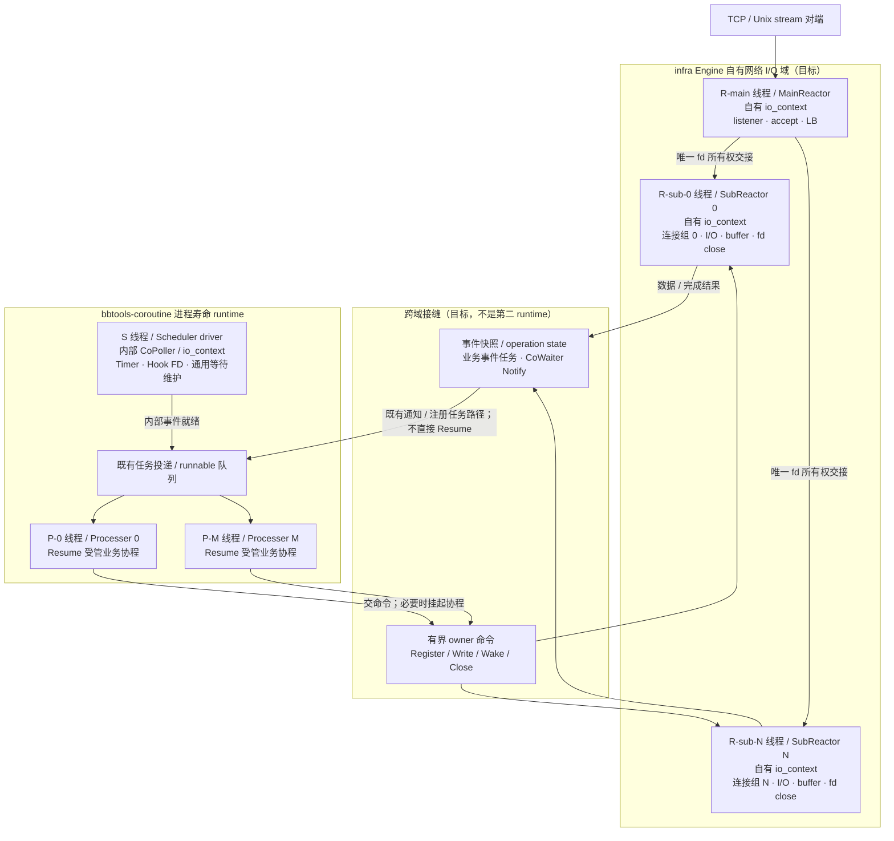
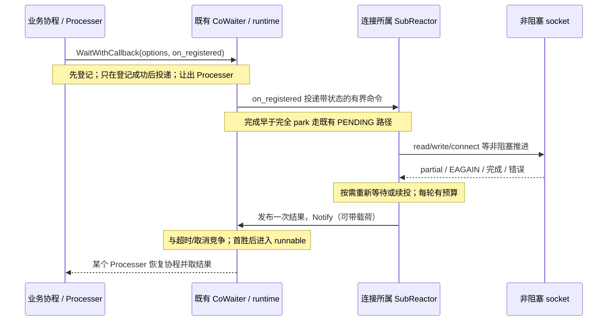

# gnet 风格网络：执行域、物理线程与所有权

**状态：2026-10-16 P3 修订候选，整体 F4 仍未验收。** 当前首包实现及局部验证见 [0010](../decisions/0010-gnet-network-foundation.md)，剩余工作与验收见 [迁移计划](../plans/gnet-network-migration.md)。本文是新 `bbt::infra::net` 执行模型的权威说明；0010 继续保存逐符号、Options、视图与 Close 契约，不在这里复制接口清单。

## 1. 决定与适用范围

采用 **coroutine 执行域与 infra 网络 I/O 域分离**：

- coroutine 的执行主体是 `Scheduler + Processers + Coroutine`；通用等待、唤醒、定时、取消仲裁、Hook 及内部 EventLoop/CoPoller 仍是 runtime 支撑能力，不因这次分层删除或迁出。
- infra Engine 拥有网络 main/sub reactor、自有线程、自有 Asio `io_context`、listener、连接、缓冲与物理收口。不是把 runtime 的共享 context 换一个名字。
- 业务事件在 Processer 上的受管协程运行，I/O owner 只推进短的非阻塞网络操作。二者通过有界命令、数据所有权交接与既有公共等待/通知能力相接，不建设第二套协程 runtime。
- `bbt-framework → bbtools-infra → bbtools-coroutine` 方向不变，coroutine 不引用 infra 的 Engine/Conn/Action。

只适用于本次新 net 路径：0005 的“proc 直接收发、sche 只检测”及 0002 的旧同步 Close 不再约束新 net。现有 HTTP/Redis/Mongo/RPC/config/MCP/旧 transport **没有因此迁移或重新验收**；保留源码并由 network-only 构建隔离，不写 framework，也不重写跨仓服务架构基线。

## 2. 目标线程拓扑

下图为默认后台 Scheduler、非 ReusePort 的 stream 接纳布局；方框中的线程均为实际 OS 线程，未承诺 CPU 绑核。`N` 个网络 owner 与 `M` 个 Processer 分别配置，不要求相等。多 listener 可由同一 main 管理，不是每连接开线程。



主图隐藏了配置/观测及错误回滚边，不表示绕过它们。Notify 的当前实现可以在通知线程触发 runtime 仲裁并把协程置为 runnable；**不要求每个网络完成先排回 S 线程**，也不表示在 I/O 线程直接 Resume。

| 角色 | 谁驱动、在哪运行 | 拥有什么 | 不负责什么 |
|---|---|---|---|
| MainReactor | 自有线程 `R-main` 驱动自有 context | listener、accept、接纳模式、LB 与 fd 交接中的唯一所有权 | 业务 Handler、连接持续 read/write、协程调度 |
| SubReactor / 网络 EventLoop | 各自唯一线程 `R-sub-i` 驱动各自 context | 归属连接、注册/撤销、非阻塞读写泵、可变缓冲、关闭终态 | 执行业务协程、跨 owner 裸访问、任意阻塞任务 |
| Scheduler | 后台 S、调用者 loop 或手动 tick，见下表 | runnable 分发策略、runtime 内部 CoPoller/Timer/维护 | accept/协议/连接缓冲、网络 owner 线程、业务优雅退出 |
| Processer | worker 线程 `P-i` 取任务并 Resume | 当前协程的执行；运行段内同一协程只有一个执行者 | 网络 fd 所有权；等待 socket 时阻塞物理线程 |
| Bridge | 由两端分别调用既有公开入口 | 一次 operation state 与移交数据的明确寿命 | 新调度器、第二套等待状态机、强制指定恢复线程 |

### 布局变体与驱动权

- **ReusePort**：每个 sub owner 持有自己的 listener 并接纳；无独立 main。必须分别验证监听失败回滚、流量分配和收口，不能由普通接纳场景推定通过。Linux IP 的选项基础不等于 Engine ReusePort 已交付；Unix 明确拒绝该选项。
- **UDP**：按 listener/数据报 socket 的 owner 推进读写，保留报文边界；不虚构 TCP 式 accept/每 peer 独立 fd，也不强套 stream 的 ET 读泵。
- **Client**：无 main accept，复用 sub owner 做非阻塞 connect/登记/关闭，不新增第二套 runtime。
- **线程隔离**：网络 context 只由自己的 driver 推进；单连接状态按 owner 串行化。不承诺 CPU affinity、内存或故障隔离、业务实时性，也不强迫业务协程返回原 Processer。

runtime 已有启动模式不改变：

| `SchedulerStartOpt` | 内部 CoPoller 的 driver | Processers |
|---|---|---|
| `SCHE_START_OPT_SCHE_THREAD` | 新建 Scheduler 线程；Start 初始化后返回 | runtime 创建 worker 线程 |
| `SCHE_START_OPT_SCHE_LOOP` | 调用 Start 的线程进入 `_Run()`，不返回 | runtime 创建 worker 线程 |
| `SCHE_START_OPT_SCHE_NO_LOOP` | 宿主唯一驱动线程持续调用 `LoopOnce()` | runtime 创建 worker 线程 |

手动 tick 停止推进不是 runtime Stop；Timer/延迟清理等依赖 tick 的进展可能停止。网络线程继续活跃也不能代替 runtime 的 driver。不得同时后台驱动和手动 tick。

## 3. Asio 与 gnet 的复用边界

### 两个 context 域，不是重复驱动一个 context

`bbt::coroutine::io::GetExecutor()` 返回 **runtime 内部共享 context** 的投递句柄。消费者不得给它新开 run/poll 线程，不调用其 stop/restart，也不把它注册到网络 owner 的 driver。它仍由 Scheduler 的唯一驱动路径推进。

新 net 则创建并管理自己的 context；这是对旧“所有上层适配器不得创建独立 context/线程”适用范围的显式修订，而不是放宽共享 executor 的驱动权。现有 `IoExecutor.hpp` 关于 generation/调度停止的旧注释不是恢复已删除 Stop/restart 的依据。本轮 coroutine 只更正文档，不改该头文件。

首个网络后端使用已有 Boost.Asio 事件能力，**不强制套用 coroutine 的 `bbt::pollevent::Event` 接口来表达全部 gnet 语义**。此前局部探针观察到的撤销栈重入，只是该公共包装的当前行为，不等于 Asio 不能承载多 reactor，也不是已复现 UAF。网络 adapter 必须自己定义撤销完成、在途 callback 与对象释放的关系并通过测试；不以先扩张 coroutine poller 为 P3 前置。

### 参考结构，不照搬 Go 执行栈

固定 gnet v2.10.0 的普通 Unix 布局为每 main/sub 各一个 goroutine 与 poller。`OnTraffic` 从 sub eventloop 的读取栈直接调用，不是每个 readiness 新建 goroutine。只有配置 `LockOSThread` 才将 reactor goroutine 固定在 OS 线程；ReusePort 使用各 loop 自接纳布局。

本方案保留其接纳交接、单连接 owner、按需写就绪、读写泵、缓冲、事件顺序及 Action 思路；**额外 native I/O 线程 + 可挂起业务协程分离是刻意差异**。不能因为同为 Asio、executor 或 strand 就宣称已获得 Processer 亲和：strand 只串行 handler，不固定 OS 线程，也不能替代有栈协程的恢复约束。

### LT / ET 的位置

应用通过读取策略选择 LT 风格的有预算反复读取，或 ET 风格的 drain-to-EAGAIN；预算耗尽向同 owner 续投，高水位暂停读取并在消费后恢复。部分写、按需写就绪、续投公平性与背压属于 Conn/网络 adapter。

这不是把底层 native LT/ET flags 当作 Asio 已公开的能力：Asio `async_wait` 没有逐 fd 切换 `EPOLLET` 的公开开关；其后端内部使用 EPOLLET 也不自动兑现应用的 gnet ET 语义。必须记录实际提供的读泵策略、事件合并及恢复行为，不承诺 native LT/ET 通知次数等价。UDP 另测数据报策略。

## 4. 跨域调用与完成时序

下图是一次**需要等待的操作**，不是所有 Reader/Writer 方法都必须等待内核发送。缓冲消费、写接纳、真正发送、回调完成与对端处理结果，仍按 0010 分开。



必须满足：

1. **登记先于投递**：登记失败不能留下孤儿命令；命令队列满/关闭拒绝必须完成失败路径，不能让等待者无限挂起。发布数据与 Notify 的同步关系要由 operation state/队列契约保证，不能靠“shared_ptr 所以线程安全”。
2. **首胜与迟到**：完成、超时、协程取消、Close 只交付一次业务终态。超时/取消返回不等于底层 I/O 已结束；操作状态、缓冲与 fd owner 保活到最后内核访问及 callback 结束。`CoWaiter::Cancel()` 不是业务取消唤醒入口。
3. **不直接恢复业务**：owner 使用已有 Notify/任务注册路径，不调用 detail Resume，不指定“恢复到这个 Processer”，不复制 runtime 仲裁状态机。不存在新的 `Task<T>`、CompletionSignal 或 CancellationToken 依赖。
4. **投递有界**：同连接至多一个活跃业务事件，readiness/Wake 可以合并；不能每次就绪无限创建协程或任务。各连接仍需公平预算。数据、命令、待发/待收量及事件数都有边界，满时显式背压/拒绝，不静默丢业务数据。

## 5. Handler、数据与执行上下文

- I/O 线程处理非阻塞 native I/O、注册/撤销、物理 close、短的非挂起完成项。业务 `OnOpen/OnTraffic/OnClose`、engine 生命周期与 Tick 事件进入受管协程；同连接事件不重入，engine 生命周期/ticker 各有自己的串行事件位。
- handler 可以挂起；挂起期间网络 owner 可继续运行，但不可修改当前事件的 backing storage。Reader 只借独立事件快照，cursor 由当前业务事件持有；view 的有效期与使其失效的操作继续遵守 0010。
- Writer 将不可变数据所有权转给 owner，或显式复制；不跨域裸借 reactor 的 mutable ring，也不持有 OS mutex 跨挂起。零拷贝优化必须先有可验证的寿命契约，不能先假定安全。
- handler 返回 Action 后回投 owner；Closing/Closed 首胜后晚 Action 不能重新开放连接。同连接业务顺序不得因跨多个 Processer 调度而改变。异常/拒绝的具体映射在 P3 接口冻结与测试中明确，不在此伪称已接线。
- `ICoObject` 每次操作现查受管协程环境，不能缓存创建线程/TLS；I/O owner 身份是另一判断。非挂起标签不代表协程外合法或线程安全；`NativeSocket` 是 owner 的低层 primitive，不冒充 Co 业务对象。

## 6. 网络关闭，不是 runtime 停机

runtime 保持进程寿命、初始化一次、无 `Scheduler::Stop()`/restart，不终止或 join runtime worker。

**2026-10-16 用户修订的 Engine 目标契约（待实现）**：按通常全局、贯穿进程的使用方式设计；实例关闭采用强制停止服务，不建设业务优雅排空协议。关闭线性化后拒绝新的 Listen/Connect/连接业务操作，撤销或结算在途网络工作，不再启动新的业务处理；已经运行的用户协程不能被 C++ 强杀，恢复后也不得重新开放服务。已有等待必须得到关闭结果或按既有 deadline/取消契约退出，不能因停止 I/O 驱动而遗留无期限等待。

Engine 关闭不等待用户 Handler/OnClose 返回，不承诺待发数据送达，也不把全桥 `WaitDrained`、所有句柄归零、全部 FD/线程/内存已释放作为返回条件。关联对象和资源按明确的所有权、RAII 与最后一个合法使用者自然销毁；允许用户保留已经关闭的连接句柄。句柄后续业务操作必须安全拒绝，身份快照仍可读；不得访问已经销毁的 owner/bridge。自然销毁不等于裸引用悬空、引用环常驻泄漏、遗失等待者或分离线程。具体 owner 撤销及销毁同步仍须实现和验证，不能将服务已关闭写成资源已全部回收。

此前候选的“必须先成功 drain 才可析构，否则 terminate”不采纳；析构不负责业务优雅退出，不以未调用显式 Close 为理由终止进程。I/O 线程本身的安全退出/回收是资源拥有者的责任，不扩成等待业务回调的析构流程。本修订针对 Engine，不删除下述连接 `CloseMode` 的物理完成约定；内部 drain 可作为观测/测试工具，不再是 Engine 关闭成功的业务门槛。

连接继续采用 0010 的 `CloseMode::{Block, Unblock}`、无默认值、同一个 `Open → Closing → Closed` 推进。Unblock 成功仅表示封口并可靠投递；Block 仅在受管协程挂起等待**物理完成**，不阻塞 Processer，不等待自身 `OnClose`。普通控制线程 Block 未开放；owner/main 驱动线程不得等待自身。

物理完成必须发生在事件撤销、最后内核访问和唯一 fd 关闭之后；OnClose 在当前业务事件归还后串行执行。晚到 callback 只能清理其拥有的状态，不能访问已释放连接或复用后的 fd。Engine 回收还需兑现自有 driver 退出/join 与最后 callback 的寿命，不能以 `io_context::stop()`、成功 cancel 或某次函数返回替代完整释放证据；不能让 reactor 自 join，也不能依赖 runtime 静态析构清理业务资源。

### owner 安全脱离的调用顺序（私有 bridge 切片，已局部验证）

强制停止后的收口顺序在私有 `ConnectionBridge` 上是**显式契约**，不是「释放桥即随 RAII 自然销毁」的隐含假设：

```
owner 域 StopServiceOwner（封服务 + 物理关闭全部连接，不等待 handler）
  → 控制线程 RequestStop + Join（全部 owner/asio 回调完成；owner 线程回收）
  → DetachOwner（owner 的 io_context 仍存活时逐会话断开 owner 域 backend，
     并释放 registry 强持有；前置核查每会话已物理关闭）
  → owner/context 与 bridge facade 可自然销毁
  → 外部 shell / 活动 handler 继续合法收尾
```

- **前置即拒绝**：存在未物理关闭的会话时 `DetachOwner` 不发布 detached、不清 registry、不拆 backend，返回 `operation_in_progress`；避免半脱离（强拆活 socket、丢 waiter、丢物理收口责任人）。
- **context 先毁不是 UAF**：断开 `StreamConnection`/socket 发生在 owner context 仍存活时，此后 registry 清空、owner/context 销毁，残留 shell 的析构不再触碰已销毁的 io_context。不新增 reaper、不 detach 线程、不要求 owner 活过所有 shell。
- **强停 ≠ 已脱离**：内部记账与快照归还走只受「owner 是否可达」约束的内部投递门（业务事件/命令入口仍保留封口拒绝）；强停压掉的 `OnClose` 不会在脱离后变成 drain 成功——`Drained()`/`WaitDrained` 在脱离后沿用脱离前冻结的真实结果（已证 drained 或保守 false），不把空 registry 当已完成。
- **析构不在桥锁下**：registry 与 backend 先交换到局部、再于短锁外销毁；该性质由「用户析构重入桥观测门不自死锁」的 local case 证明，不是「用户析构不得重入」的额外限制。
- **封口窗口也能收尾**：handler 可以在 `Join` 之后、`DetachOwner` 之前返回。快照归还命令被 `Sealed` 拒绝且会话已经物理关闭时，本地释放借出资源并清理 pending，不增加虚假归还错误，也不伪造 backend 的 `snapshots_returned` 计数；owner 仍可受理时继续真正归还。已接纳命令的迟到完成、队列满等真实错误不走本地丢弃分支。
- **脱离发布后不再复制登记表**：锁外直接遍历已转移的 registry 释放 backend，不在发布 detached 后分配临时会话列表。局部测试在控制线程拒绝全部 C++ `new`，断言脱离成功、零分配尝试且 backend 已销毁，再销毁 context，避免异常后重试虚报成功。

本节只是私有 bridge 切片的局部验证结论，**不是 Engine 关闭契约的实现**：公共 Engine/accept/connect/UDP/示例、Engine 级 drain 门槛与业务优雅排空仍未实现。

## 7. 当前实现与后续门禁

当前仅有 `bbt::infra_net` foundation/上下文/native socket 与纯逻辑缓冲/Options/LB 候选。独立网络 driver、Engine/Conn、上述 Bridge、Handler 接线和 Close(opt) **尚未实现**；Debug/Release 首包各 16/16 不能充当这些能力的验收。coroutine 查询修复所消费的精确 SHA 与 main 是否合入分开记录。

P3/P4 的最小真实证据应覆盖：

- 记录 main/sub/Scheduler/Processer 的线程 ID 与 context 身份，证明各 driver 不混用；同连接 owner 固定、业务恢复线程可变。
- 一个业务 handler 挂起时，其他连接和网络 owner 继续进展；同连接 handler/Action 不重入或乱序，有限 readiness 不产生无界协程。
- 跨线程早完成、队列满、登记失败、超时/取消/关闭竞争及迟到 completion；首胜一次、操作状态不提前释放。
- 两种读策略的 partial/EAGAIN/预算续投、高水位恢复、慢消费者；stream 与 UDP 分别验证。
- 单次 fd 移交及失败回滚、部分启动失败、混合 Block/Unblock、撤销/在途 callback、fd 复用与最终 FD/线程/缓冲回落。

文档审查和 docs-only CI 只能证明文档阶段，不证明本节门禁通过。

## 8. 固定来源与两仓分工

- infra 基线 `3136d1de5031a2eec55475e770d5ebbadc3c32da`；新代码候选范围与固定 coroutine 消费版本见 [0010](../decisions/0010-gnet-network-foundation.md)。
- coroutine 当前 main 基线 `39fdfff71a8a66d98a874b2e71408f9936b1166b`：[`Scheduler::Start/LoopOnce/_CreateProcessers`](https://github.com/yqm-307/bbtools-coroutine/blob/39fdfff71a8a66d98a874b2e71408f9936b1166b/bbt/coroutine/detail/Scheduler.cc)、[`CoPoller::PollOnce/NotifyCustomEvent`](https://github.com/yqm-307/bbtools-coroutine/blob/39fdfff71a8a66d98a874b2e71408f9936b1166b/bbt/coroutine/detail/CoPoller.cc)、[`CoWaiter`](https://github.com/yqm-307/bbtools-coroutine/blob/39fdfff71a8a66d98a874b2e71408f9936b1166b/bbt/coroutine/sync/CoWaiter.hpp)、[`IoExecutor`](https://github.com/yqm-307/bbtools-coroutine/blob/39fdfff71a8a66d98a874b2e71408f9936b1166b/bbt/coroutine/io/IoExecutor.hpp)。引用解释当前代码，不把本次目标冒充这些 SHA 已实现的能力。
- coroutine 的 runtime 稳定边界由其 `agent-docs/2026-09-07-core-runtime-contract.md`、`api-reference.md`、`user-guide.md` 维护；本次文档 PR 独立于查询修复 [#388](https://github.com/yqm-307/bbtools-coroutine/pull/388)，由用户合并。infra 本文维护网络线程/owner/bridge；双方不复制对方完整接口或 framework 服务语义。
- 固定 gnet `58b59a11350707153f8c48369693ab9beba7b2fa`：[`engine.activateReactors/start`](https://github.com/panjf2000/gnet/blob/58b59a11350707153f8c48369693ab9beba7b2fa/engine_unix.go)、[`rotate/orbit/run`](https://github.com/panjf2000/gnet/blob/58b59a11350707153f8c48369693ab9beba7b2fa/reactor_default.go)、[`accept0`](https://github.com/panjf2000/gnet/blob/58b59a11350707153f8c48369693ab9beba7b2fa/acceptor_unix.go)、[`eventloop.read`](https://github.com/panjf2000/gnet/blob/58b59a11350707153f8c48369693ab9beba7b2fa/eventloop_unix.go)。未运行 gnet 压测，不声称性能等价或优于它。

## 9. 测试进程退出约定与已知限制

当前 runtime 模型没有 Stop/重启/优雅停机：调度线程随进程存活，公共契约（U1 §6）即"runtime 进程寿命"。由此有一个**未修复的已知退出限制**：启动 runtime 的测试进程从 main 正常 `return`（或 `exit`）进入静态析构后，runtime 线程仍可能 `PollOnce` 延迟销毁 Event → `CancelListen` → `DelEventCallback` → 对已析构的 `Event::m_callback_map` 执行 `erase`（是 erase 非 find）→ SIGSEGV（GDB27/exit-forensics-24 受控交错复现，DSO 197a45）。

约定（`tests/net/ProcessRuntimeTestMain.hpp`，测试私有，不是产品 API）：已启动 runtime 的测试 main 一律经 `bbt_net_test::RunTestProcessExit` 收口，真实入口如 `tests/net/co_bridge_contract.cc` 末尾的 `main`（目标 `Test_net_co_bridge`）。推荐写法是一 case 一独立进程，顺序固定为：

```
case 作用域 → 业务资源显式 close/join（socket/listener/owner loop、callback/ticket/snapshot 配对、FD/线程回 warm 基线）→ 断言 → 原退出码 → flush C++/C stdio → std::_Exit(code)
```

边界与限制，逐条准确陈述：

- `std::_Exit` 不跑静态析构与 atexit，也不展开当前栈；所以局部对象必须先离开作用域，wrapper 只在原测试函数返回（所有测试局部 RAII 已真实析构）后调用它。业务资源清理与断言保持在 `_Exit` 之前完成，不以 OS 代清作为通过证据。
- 失败仍失败：原非 0 返回不变 0；未捕获异常/terminate/abort/信号/外层 ctest 超时不被转换成功；本头不注册 atexit、不安装/吞掉信号，崩溃/超时保持非 0 并留日志。
- `_Exit` 只是规避测试进程退出竞态：不是 runtime 资源回收证据，不验证全局/静态 RAII，不向生产库推广；普通 `return`/`exit` 对启动 runtime 的进程仍不安全，本节不声称已修复。
- 需要验证普通 return/静态析构/全局资源寿命的用例，须另设明确的生命周期测试，不得套用本 helper 宣称验证通过。
- 跨进程资源（临时文件、外部服务/共享记录/子进程）不依赖 OS 终止自动恢复，须在 case 内清理或由外层监督回收。
- 未启动 runtime 的工具测试（如 `Test_net_primitives`、`Test_net_allocation`）保持普通 return，不用此边界。后续优雅 runtime 停机另行任务，本轮不建设。

本地命令示例（独占构建目录，新 configure 必加 ccache）：

```sh
cmake --build build --target Test_net_co_bridge --parallel 3
ctest --test-dir build -R '^net\.co_bridge_lifecycle$' --output-on-failure
```

## 10. 首包公共 Engine（2026-10-16，本地验证，未审查/未合并）

真实 TCP 单 main listener + `num_event_loop` 个 sub owner 的公共闭环已实现并本地验证
（`tests/net/engine_server_accept.cc`，目标 `Test_net_engine_server`，5 个 case）：

- 公共表面：`Engine`（`Run`/`Stop`/`LocalAddresses`/`CountConnections`）、
  `EventHandler`（默认空实现基类，public virtual 析构，不是别名壳）、
  `Action::{None,Close}`。`LocalAddresses` 以显式 `error_code` + out 参数返回
  **实际绑定地址**的稳定快照（请求 port 0 时是内核分配的真实端口），
  未运行/被拒时不改写 out。
- 执行域：accept 在 main owner；`LoadBalancer`（复用三算法；LeastConnections 用每
  sub 真实 session 计数）选 sub → 唯一 fd 移交 sub owner → 既有私有 bridge 接纳 →
  受管 `OnBoot/OnOpen/OnTraffic/OnClose`。`Action::Close` 在事件协程内对该连接
  发起真实 `Close(Unblock)`（空原因=干净关闭）；未交付动作不出现在枚举里，也不降级。
- `Run`/`Stop` 是 native 控制线程生命周期入口：受管协程内或本 Engine owner 线程内
  在**任何副作用之前** `operation_not_permitted`；`Stop` 以 `error_code` 返回结果
  （无 `void noexcept` 吞错承诺）。`OnBoot` 在开放业务接纳**之前**执行并等待完成
  （内部截止 10s，超时以 `timed_out` 失败回落，不留半启动）。运行中重复 Run →
  `already_exists`；Stop 后 Run → `operation_canceled`（终态）；Stop 幂等。
- 强停顺序（Stop 与析构共用）：撤 listener 就绪等待并关 listener → join main owner
  （此后不再有新的 handoff 提交）→ 每 sub barrier 清在途 handoff → 每会话物理全闭 →
  `RequestStop`/`Join` → context 仍活时 `DetachOwner` → owner/context 销毁。
  不等 handler/OnClose/drain，不 terminate/detach 线程、不新增 reaper、不重开 runtime
  停机。挂起 handler 的晚归还与晚操作按既有 detached 契约收尾：`Write`/`Wake` 明确
  `operation_canceled`，`Close` 为幂等观察，`Peek` 视图在 owner/context 销毁后仍安全。
- 未接线请求显式 `operation_not_supported`（`reuse_port`、keepalive 三字段、
  socket recv/send buffer、`edge_triggered_io`、`multicast_interface_index`、
  `bind_to_device`、`lock_os_thread`、`log_path`/`logger`），不静默忽略。
- 接受集只有 IPv4（**2026-10-17 修订，本地验证未审查/未合并**）：`Run` 对 Unix/IPv6 等
  **合法**但未支持的家族在 owner 线程/listener socket/OnBoot 登记**之前**
  `operation_not_supported`，不 bind、不发布 `bound` 快照、不进入 `Starting`/`Stopped`
  （可换 IPv4 地址重试）；空/无效 `Address` 仍是 `invalid_argument`，域门禁与 busy/canceled
  优先级不变。旧实现在 Unix 上是**假成功**（bind 成功、快照发布、`error=0`，却零业务事件，
  146 探针 2.1 实证）。接纳路径当前只服务 IPv4 stream（`StreamConnection::Create` 的家族门）。

- ticker/`OnTick`（**本地候选，未独立审查/未合并**）：`Options::ticker == true` 时 Run
  进入 `Running` 且 accept 就绪等待挂好后立即在受管协程投递第一次 `OnTick`；engine 全局单
  ticker、同刻至多一次（重挂只在返回后发生）；返回 delay 决定下一次投递，`<= 0` 停止 ticker
  （Engine 继续 `Running` 与接纳，不是 Shutdown/强停）；极端返回值按 `steady_clock` 半程与
  `nanoseconds` 可表示上限的较小者饱和（换算先比较后转换，与时钟周期无关；溢出保护，不是
  业务时限上限）；Stop/启动回落取消 timer 并拒绝重挂，在途 tick 自然完成（不等 handler）。
  重挂在受管协程内经**每代窄门的稳定 owner 投递句柄**非阻塞提交（`TickState` 持 loop/owner/
  handler，发布与撤空同锁），**不取 `control_mutex_`**：Stop 全程持该锁（含 15s owner 命令
  等待与 Join）时也不会阻塞唯一 Processer。投递被拒（owner 队列满/已封口/未启动）或抛出时
  ticker 明确停止并记内部停投原因（Engine 继续服务、不重试、无 reaper，不新增公共观测 API）。
  用例 `net.engine_tick_*`（`tests/net/engine_tick.cc`，含 Stop 长锁窗口内唯一 Processer
  进展与 owner 队列 Full 拒绝两条）。Client 仍拒绝 ticker（无 engine 级 tick 事件的承接者）。

- **接口/ABI 变更（重编译要求）**：`EventHandler` 新增虚函数（`virtual std::chrono::nanoseconds
  OnTick()` 与 `virtual void OnShutdownRequest()`）属公共接口变更，**既有已编译消费者必须全量重编译**，不能与按旧头编译的二进制/
  目标文件混用（vtable 布局改变；本仓不做二进制兼容承诺，未做 ABI 混链验证）。消费方升级
  本仓后应重新编译自身全部链接 `bbt::infra_net` 的目标。

本首包**未交付**（不声称、不写进交付状态表）：`OnShutdown`（已关闭生命周期通知）、
协程发起的 engine 强停、Engine 级 graceful drain /
FlushPolicy、多 listener、UDP 与 connect/client、日志出口接线、Release 构建与 CI 全量。
这些仍属 0010 的后续阶段，不能在 README 或交付状态中记为已交付。新增代码使用普通
`new`/`make_shared`，无对齐（aligned）分配声明。

其中 **UDP 高层入口** 已由用户于 2026-10-17 明确定为**本轮暂缓**（见 0010「范围与版本」）：
不实现 datagram 的 `Engine`/`Client` 面，只保留 `<bbt/infra/net/Udp.hpp>` 的显式使用时编译拒绝
（该头只含 `#error`，不进聚合头与自检），因此它不是本轮的必过阻塞项；`NativeSocket` 的 datagram
原语（`SocketType::Datagram`/`SendTo`/`ReceiveFrom`）仍是原语层能力，不受影响，也不写成 UDP 整体未实现。

**本轮（2026-10-17）用户裁定**：`Action::Shutdown`（值 2）已实现为**向上请求上报**——向上层传递、
自由度给使用者（本地候选，未独立审查、未提交）。`Action::Shutdown` 不含任何自行动作（不封口、
不停 ticker、不 Stop、不改 `stopping_`/`phase_`、不拒绝后续业务）；`EventHandler::OnShutdownRequest()`
（默认空实现）是上报口，由 `EventHandlerAdapter::ApplyAction` 在产生该事件的**同一受管协程任务**
内同步转发一次，可重复上报、无首胜，上报回调不返回 Action（无自激）；`ServerEngine`/`Engine`
零 diff，物理强停仍只来自控制域的既有 `Engine::Stop()`/析构。旧的「Shutdown 自动收口」表述作废；
用例 `net.engine_shutdown_request_*`（`tests/net/engine_shutdown_request.cc`）。

## 11. 首包公共 Engine 计数/寿命修订 F1/F2（2026-10-16，本地验证，未审查/未合并）

独立审查（engine-review-42）判定 F1/F2 后本地修复：`EventHandlerAdapter` 不再持指向
`ServerEngine` 成员的裸计数指针，改为与 Engine 共享的
`std::shared_ptr<std::atomic<std::size_t>>`（每次 `Run` 新代，无跨代别名）；`OnClose`
用 RAII guard 在作用域退出完成恰一次减计数（正常返回/用户抛出/跨挂起都不漏减），
guard 持共享计数 ⇒ `OnClose` 挂起跨 `ServerEngine` 销毁时仍保活计数对象，不写已释放
内存。停止时不再清零陈旧计数（避免迟到 `OnClose` 无符号下溢），对外 0 由 sub 清空表达。
真实 TCP 新 case：`net.engine_onclose_throw_count`（F2，先真实红后绿）、
`net.engine_onclose_suspended_stop_destroy`（F1，含白盒共享计数 weak/value 证据）。
本修订**不是** Engine 验收通过：F3–F8 未销项，无 ASan/Release/全量 CI，独立复审仍须；
F1 无确定动态红（本环境无 ASan，仅静态可达 + 修后共享计数寿命证据，不伪造 UAF 复现）。


## 12. Engine 拥有型 Handler 入口与 Boot 独立持有（2026-10-16，本地验证，未审查/未合并）

用户已确认所有权变更、认可框架内维护生命周期资源，本切片按此落地；不是线程安全声明。

- **唯一拥有型入口**：`explicit Engine(std::shared_ptr<EventHandler>)` 按值接收并持有，
  不留 `EventHandler&` 借用兼容重载，也不用 no-op deleter 构造假拥有。构造允许空
  shared_ptr（文档写明），但 `Run` 在任何线程/socket/受管任务副作用之前以
  `invalid_argument` 拒绝空拥有关系；未 Run 时 `Stop`/`LocalAddresses`/`CountConnections`
  按未运行语义返回，不解引用。
- **共同持有**：`ServerEngine` 与 `EventHandlerAdapter` 同样按值持
  `shared_ptr<EventHandler>`；适配器被 ServerEngine 与每会话 registry/挂起中的事件回调
  共同持有 ⇒ 挂起中的 `OnOpen/OnTraffic/OnClose` 期间 handler 不会析构。解决的是
  handler 在强停/销毁窗口的悬空引用（UAF）所有权面。
- **Boot 不保活 ServerEngine**：`RegisterBoot` 的登记闭包只按值捕获 handler 与窄结果句柄，
  不捕 self/this/ServerEngine/adapter 或网络资源。原 10s deadline 不变：到期只让 `Run`
  以 `timed_out` 回落，已经开始的 `OnBoot` 不被取消、不被强杀，任务自身持 handler ⇒
  Engine 销毁后仍安全收尾。**未开始的 Boot 取消与 F6/F7 已由 §13 落地**；F4/F8 仍不在本切片内。
- **析构线程**：handler/adapter 的析构线程是最后一个拥有者所在线程，可能正是受管协程；
  不保证在控制线程析构、不得阻塞 worker/owner 线程；handler 析构不回调 `Engine::Stop`、
  不引入 reaper。
- **不变**：runtime 与强停语义不变（不等 handler/OnClose/drain、不 terminate/detach、
  不重开 runtime 停机）；F1/F2 共享计数保持。**无库内强环**：业务回调只持 handler 与其
  连接句柄，不反向持 `Engine`/`ServerEngine`；用户自建的反向持有是否成环不在本库保证范围内。
- 本切片**不是** Engine 验收通过：F3–F8、LC/namespace 未销项，无 ASan/Release/全量 CI，
  独立复审仍须。

## 13. Engine 启动相位 / Boot 观测 / 并发停止收敛（2026-10-16，本地验证，未审查/未合并）

实现范围：F3（未开始 Boot 取消）、F6（OnBoot 内观测不再堵 worker）、F7（facade 竞态与
Stop 终态）。`ServerEngine` 相位扩展为 `Idle/Starting/Running/Stopped`；状态与网络资源仍由
同一 `control_mutex_` 短锁串行化，但**没有任何 mutex 跨 OnBoot 等待**。

- **Run 两段式**：锁内校验 → 起 owner → 绑定 listener 并发布实际地址快照 → 登记 Boot 任务
  （闭包只按值持 handler 与窄结果句柄）→ 发布 `Starting` → 解锁；**锁外**等待 OnBoot（原
  10s 截止不变）。Boot 完成后重新取锁：若已被 Stop 抢先（`Stopped`）直接 `operation_canceled`
  且不再触碰 owner/`armAccept`；超时或 `OnBoot` 失败走原有启动回落（撤 accept 等待 + 回收
  owner/context/FD，回到 `Idle` 可重试）。
- **并发 Run/Stop**：`Starting`/`Running` 期间重复或并发 Run → `device_or_resource_busy`；
  `Stopped` 是终态 → `operation_canceled`，Stop 首胜不会被后续 Run 覆盖回 `Running`；
  未 Run 的 Stop 也进入同一终态（随后 Run → `operation_canceled`），已停止时幂等成功。
- **Starting 可真实强停**：Stop 对 `Starting` 执行与 `Running` 相同的收口（撤 listener 就绪
  等待/关 listener → join main owner → 每 sub barrier + 物理全闭 + `RequestStop`/`Join` +
  `DetachOwner`），不等 OnBoot 完成、不等业务回调；`Starting` 只在 owner/绑定全部就绪之后发布，
  因此不需要在未 `armAccept` 的部分构建状态上做特殊分支。
- **未开始的 Boot 取消**：每 Run 一个窄 `BootResult{mutex,cv,abandoned,started,done,ok}`，
  任务侧在 mutex 下完成 `Pending→Running` 与 `Pending→Abandoned` 的窄 CAS；Stop/超时置放弃位
  并唤醒等 Boot 的 Run ⇒ 尚未开始的任务不进入 `OnBoot`（解决 check-TOCTOU），而**已经开始**
  的 `OnBoot` 拥有 handler 自然完成，不被强杀、不无限等待。未引入通用取消框架。
- **跨代 OnBoot 重入栅栏**：超时回落若旧代 Boot 已开始未完成，`ServerEngine` 保留其窄
  结果句柄（不保活任何网络 context）；下一次 Run 见 `started && !done` 即拒绝
  `device_or_resource_busy`，同一 handler 不跨代重入 `OnBoot`；旧任务自然完成后清柄放行
  重试。`Stopped` 终态先行，Stop 仍不等待 Handler。
- **观测面（F6）**：`Starting`（已发布实际地址快照）即可 `LocalAddresses`（OnBoot 内合法调用），
  该相位 `CountConnections()` 为 0；`Running` 读本代计数；`Stopped` 拒绝地址、计数为 0。
  观测只取短锁、持锁路径不等业务 ⇒ OnBoot 内观测不会与 Boot 等待互锁，也不占住 Processer 等锁。
- **facade**：`Engine` 用独立短锁只发布/读取稳定 `shared_ptr<ServerEngine>`（在 nativeRun
  之前发布），所有 `server->X` 都在锁外调用，facade 锁不跨 Run/Stop。
- 测试：`net.engine_boot_observation`、`net.engine_stop_during_boot`、
  `net.engine_stop_before_run_and_contention`、`net.engine_boot_pending_abandon`（新 case 在
  原实现上先红后绿）+ 原 57 case 精准回归。**未销项**：F4 整体（故障域见 §16）、
  F8（停止线性化后未开始业务封门）、LeastConnections/namespace、无 ASan/Release/全量 CI；
  本切片不代表 Engine 验收或可合并，独立复审仍须。

## 14. F8 停止开始授权最小切片（本地验证，待独立审查）

本节更新前文 F8 的进度，不表示整体 F8/F4 或 Engine 已验收。

- **开始的定义**：在与封门共用的 `ConnectionBridgeState::m_` 短锁内取得一次不可撤销
  授权；不是 CPU 已执行用户函数第一条指令。授权前不得产生用户业务副作用；已授权工作
  视为在途，可自然完成。锁不跨 handler、backend 调用或等待，不等待 handler 返回。
- **Engine 停止线性化点**：`StopLocked` 先对全部现有 sub bridge 调 `SealService()`，
  然后发布 `stopping_=true`，再执行原有 listener/handoff/物理关闭顺序。封门期间可提前
  拒绝，但该发布点后不能给任一桥新的开始授权。`SealService` 仅置原有服务位，不遍历
  registry、不访问 socket，也不替代物理收口；`StopServiceOwner` 复用封门，已封也继续关闭。
- **排队执行复查**：`Write` 的 owner 执行体在同锁内重新授权，被拒必须
  `Complete(operation_canceled)`，不调用 backend、不丢等待者。单纯入队检查不足。
  `Adopt` 保留原有同门检查，排队 handoff 被拒后由 holder 的唯一 fd RAII 收口；已获授权
  的 Adopt 仍由同 owner 负责完成或按 P1 回滚，不因控制线程封门丢登记责任。
- **沿用已有门而非新框架**：Open/Close 的 `RunEvent` 门、Traffic 在取得快照可能挂起后的
  最终授权继续沿用；Wake 到达只合并事件位，真正业务仍过 `RunEvent`。已接纳的 Close、
  物理等待者结算、Internal 快照归还/取消清理不作为新业务统一静默丢弃。
- **实际证据粒度**：`tests/net/co_bridge_service_gate.cc` 的四个真实 TCP case：
  `queued_write` 用 owner 门闸和 linkwrap 的实际 `Submit=Accepted` 握手，封桥后放行，
  断言 waiter 取消、backend accepted/sent 均为 0、对端 EOF；`pending_open` 与
  `pending_traffic` 用单 Processer 原生 nanosleep 门闸，后者先确认真实 read notification，
  只封桥而尚未物理关闭便放行业务，断言不进入尚未授权事件；`engine_handoff` 用测试独立
  linkwrap 在 owner 已取出但原 handoff 闭包未执行的位置阻塞，在 Stop 首个资源命令
  （停止发布点之后）被接纳后放行，确认 backend Create=0、OnOpen=0、真实 EOF。
  这不是“handoff 仍在 EventLoop deque”或全部多 sub 交错的穷举证明。
- 新 fixture 原样在仅新增 SealService 接口/实现、尚无 Write/Engine 修复的候选上运行：
  Write 对端收到不应发送的字节、Engine Create=1，两项真实红；既有事件门两项原已绿。
  修复后同 fixture 四项绿；旧精确 68 名单加四项共 72 项定向回归通过，unique=72、
  bad=0、skip=0，受影响静态消费者均重链并构建网络头自给目标。不是本地全量或 CI。
- **继续开放**：F4 整体未验收；持续物理关闭/Notify 失败与析构能力按 §16 用户决策不在支持域，
  不作为本轮新增兜底实施项；P1 锁外 registry 遍历保留。
  未单独构造 Traffic 已借快照后挂起再封门的新增确定性例、多 sub 封门期间的每个交错、
  已授权 Adopt 与封门交错的所有异常点；既有挂起 handler/快照归还回归仍通过。
  F8 整体验收、LeastConnections/namespace、ASan/Release/全量 CI 均不在本切片销项。


## 16. Engine 一次性控制/关闭边界故障最小收尾（2026-10-16，本地验证，未审查/未合并）

按 engine-stop-fix-68：`SubmitCommand` 模板化后把调用点闭包构造、promise/future/claimed
分配与入队纳入函数内 try——一次性 `bad_alloc` 映射 `not_enough_memory`、其余映射
`io_error`，不向 Stop/Rollback/析构调用栈抛出；已 Accepted 后 timeout 不判撤销，晚命令
触及资源由同一收口函数内 RequestStop+Join 前保活。`CloseListenerOwner` 改返回
`error_code`（watcher cancel 用 error_code 重载，首错保留）。Stop 的每环（清 listener、
StopServiceOwner）一次性失败在同一仍存活 owner 上有界推进一次，删除 sub 空 barrier
（单条 StopServiceOwner 命令即 FIFO 收口边界）；首错保留，恢复成功仍返回首错。
收口判据为内部只读 `ConnectionBridge::NetworkCloseReady()`/会话
`PhysicalCloseSettled()`（每会话 physical_closed 且 owned 等待记录结算，非 Drained、
不等 Handler/OnClose/快照）：未收口不 ResetOwners、不发布 Stopped；Rollback 未收口
不发布 Idle（相位保持 Starting，重试 Run 得 busy），启动原错与清理首错分别保留。
StopLocked/RollbackStart 命令闭包只捕 `this`/bridge shared_ptr：每条 owner 在同一
函数内同步 Join，析构域（最后强引用）不经过 `shared_from_this()`；不建 reaper、不
泄漏、不 terminate、不跨线程强关 fd、不重开 runtime。最后引用析构下持续失败按本节
下述用户决策不在支持域，不再作为本轮兜底实施的 BLOCKED 项，也不承诺该域安全。
持续 OOM 与 runtime Notify/BeginFdClose 内部失败的历史缺口描述，以本节下述故障域
及 C1 调用链裁决为准；不据此要求上游新增持续故障恢复契约，不构成 F4 整体销项。


### 单次入队内存错误分类（71 F3 修正）

EventLoop 私有 Submit 保留原状态集合；新增带 `std::error_code&` 的私有重载，
仅把本次 push/post 失败分类传给 Engine 控制命令：`bad_alloc` 为
`not_enough_memory`，其它异常为 `io_error`。旧单参数消费者仍按原
`Accepted/Full/Sealed/Failed` 语义工作，不读取共享 LastFailure 判本次错误。
分类使用值类型，不新增分配、不重试已接纳命令、不改变强停模型。
初次 post 分配失败时仍持队列锁回滚本次命令；owner 无法在回滚前取走它。
续投 post 失败仍在 owner 连续 drain，已经 Accepted 的责任不变。

独立测试 `net.engine_stop_post_alloc_fault` 在真实 Asio post 的 aligned_alloc
分配点单次返回空，先验证未接纳命令执行零次、恢复命令执行恰一次，再经真实
TCP Engine Stop 验证首错 `not_enough_memory`、对端关闭、线程/FD 回落及幂等。
该证据不覆盖持续失败策略、Accepted 迟到命令或最后引用析构交叉故障，
不表示整体 F4 已接受。

### 强停与最后引用析构的故障域（用户已接受，非整体验收）

本轮仅承诺：runtime 健康，且故障在既有有界补偿内及时恢复时，强停与最后引用析构可完成。单次目标 OOM 的修复及该恢复域已测，T1/T3 精准 79 项已独立通过；这不是当前整体 Engine、全部 F4 或 PR/CI 的验收。上游 OOM 修复仍以 HEAD 加未提交差异 hash 标识候选，不是已锁定的新 commit。

持续资源耗尽不在支持域：不保证强停/析构完成，不保证等待者被唤醒，也不承诺持续故障下的安全析构能力。这不是允许新增 UAF 或泄漏策略；不新增泄漏兜底、强杀、无限重试或 reaper，也不扩建 runtime 停机模型。`Stop`/`Join` 没有整体 deadline；控制命令的 15s 等待超时不取消已 `Accepted` 的命令，不能据此推定物理关闭或线程回收已经完成。强停仍不等 Handler/`OnClose`，不是业务优雅 drain。

原 C1“异常导致 physical waiter 记录残留进而悬空”的具体推测撤销，并非实测漏洞：实际 `CoIoOperation::Complete` → `CoWaiter::Notify` → `CoPollEvent::Trigger` 路径中，timer 撤销的 `DeferDestroyEvent` 在同锁内对首次 `bad_alloc` 有界重做一次；再次失败沿 `_CannelAllFdEvent` → `_Complete` 上抛，被 `Trigger` 的 catch-all 吞掉并返回 0。因而 `Complete` 不会沿这条链向 `OnClosedOwner` 抛出异常，原先据此推断的 swap-back 记录残留前提不成立；这项判断来自实际调用链与异常处理，不是由 `noexcept` 标签推导。持续 OOM 仍可能使带有限 deadline/timer 的等待丢失唤醒，即记录已清空但 wake 未送达；该真实限制保留，不能以撤销原推测冒充持续故障安全。
