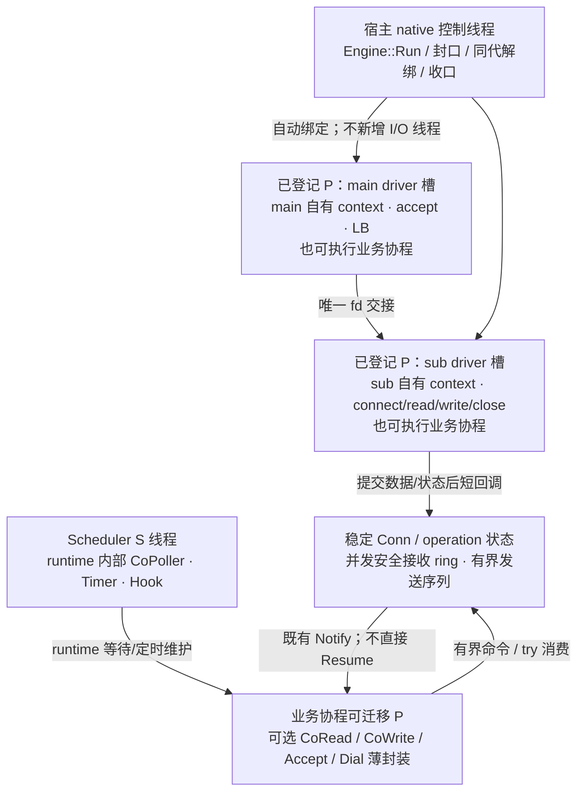

# gnet 风格网络：执行域、物理线程与所有权

**状态：R2 TCP 契约与实现已合入主线**（PR #84，合入提交 `99d0821a0175c43d9ec2fff78de1f90af068f92b`）。本文描述执行模型与生命周期约束；当前实现落点与已知缺口见第 7 节。旧线程、事件快照及局部验证记录在文末历史区保留，不作为当前实施约束或新版本验收证据。

## 1. 决定与适用范围

infra net 提供稳定可靠、并发安全、有界的 TCP 字节收发，尽可能报告可确认的接纳、进度、本地完成、EOF 和错误。这里的可靠不等于网络永不失败、数据必达或对端业务必执行。

- coroutine 继续负责 Scheduler、Processer、有栈协程，以及内部等待、Timer、Hook、CoPoller 和对象安全；进程寿命、单次初始化、无 Stop/restart 不变。
- infra 自有 main/sub Asio context、listener、socket、连接、缓冲与物理收口；每个 Reactor 绑定一个已登记 Processer driver 槽，不另建网络 I/O 线程。
- 原始入口为异步操作与短回调；协程同步接口是复用 CoWaiter/Chan 等原语的可选薄封装，不另建网络内核。
- 上层负责分帧、请求匹配、等待业务回包、重试、避让、重连及业务关闭策略。net 不因普通等待超时、读 EOF 或写错误自动关闭连接或重发。
- 本次设计覆盖完整 TCP server/client；不包含 HTTP/RPC 接入、消费者迁移、UDP/TLS、动态 owner 迁移或自愈平台。旧模块与原语保留，不因设计确认变成已迁移。
- 依赖保持 `bbt-framework → bbtools-infra → bbtools-coroutine`；不向 coroutine 下沉网络类型、缓冲或业务策略。

## 2. 目标线程拓扑

默认 THREAD 模式仍由 S 线程推进 runtime 内部 EventLoop。P 线程交替执行业务协程与非业务协程边界的 driver；业务协程可迁移 P，连接 I/O owner 固定。



| 角色 | 驱动与责任 | 边界 |
|---|---|---|
| main Reactor | server 普通布局的 listener、accept、LB、fd 唯一交接 | 一个已登记 P 的 driver 槽；不执行业务等待 |
| sub Reactor | 归属连接的 native I/O、注册/撤销、物理 close、自有 context | 各占一个 P 槽；同连接 owner 固定；非阻塞推进有预算 |
| Processer | 在 worker 线程调度业务协程并推进绑定 driver | 不给业务协程提供永久 P/CPU 亲和或实时性保证 |
| Engine::Run | 调用它的非受管、非 owner native 线程上的启动、控制与收口 | 不暗中创建控制线程或第二 I/O driver |
| Conn/operation | 共享数据与持久状态、数据所有权、有界接纳和完成责任 | 不暴露 Asio 对象，不将 shared_ptr 当作对象同步 |

server 普通布局保留一个 main 加 N 个 sub，配置 N 表示 sub 数，启动必须报告包含 main 的实际槽需求。client-only 不创建 accept owner（`EngineConfig::listen_addresses` 为空即为 client-only），ReusePort、UDP 等旧目标不自动加入本次 TCP 实施范围。

Engine 自动枚举并绑定空闲已登记 P；查询空槽不是预留，以注册成功的同代 token 为准。槽不足或竞争失败回滚本次绑定，不抢占、不扩 worker、不静默缩数量、不退回独立网络线程。

### runtime 推进前提

宿主必须在启动配置中明确声明：runtime 内部 EventLoop 由独立于 Run 的执行流持续推进。THREAD 使用已有 S 线程；SCHE_LOOP 的 Start 在另一 native 线程运行；NO_LOOP 由另一执行流持续 LoopOnce。未初始化或未声明/声明不独立，Run 在绑定或建 socket 前拒绝；当前实现口径分别是 `operation_not_supported`（runtime 未初始化）与 `operation_not_permitted`（`runtime_progress != Independent`）。

现有 Scheduler 提供 IsInitialized 和 driver 查询，但没有公开的启动模式/驱动线程存活探测。声明是宿主须履行的前提，不伪称库能证明另一线程持续进展；宿主停止推进后不能承诺协程 deadline 正常兑现。不得后台驱动与手动 tick 同时推进同一 runtime context。

## 3. Asio 与 gnet 的复用边界

`io::GetExecutor()` 仍属于 runtime 内部共享 context，不额外 run/poll/stop/restart，不注册到 infra driver。net 只由绑定 owner 推进自己的 context；解绑后的清理接管另见第 6 节。现有 HTTP/Redis/Mongo/config 等路径不因此迁移。

gnet v2.10.0 是接纳交接、owner、读写泵、缓冲及公平性的参考，不是必须逐方法兼容的模板。其 OnTraffic 在 eventloop 栈直接执行；本方案区分 owner 短原始回调与上层可挂起业务协程，不将 goroutine 当固定 OS 线程。

复用已有 Address、NativeSocket、LoadBalancer、EventRingBuffer、OutboundQueue 和部分读写机制，只补实际缺口。EventRingBuffer 当前是单 owner、非线程安全；需要最小同步访问面，不能直接宣称已有类可跨线程使用。OutboundQueue 合并字节不保留公共操作身份，须补有界记账，不能因此重造通用 Future 平台。

读泵是「有预算的非阻塞读」：单轮最多若干次 `recv(MSG_DONTWAIT)`，遇 EAGAIN 或预算耗尽即返回、由下一次 driver Tick 继续；ring 满则暂停读（`m_read_paused`），消费后由持久通知恢复。Asio 公共 `async_wait` 不等价 native per-fd EPOLLET，因此本实现不提供 edge-triggered 配置项（`Options::edge_triggered_io` 已随「API 冻结候选」删除，见决策 0010）。Wake 必须 noexcept、线程安全、有界、持久记忆早到通知（`detail/WakeHub`），不能单靠可能分配的 post 假定满足。

## 4. 跨域调用与完成时序

下表为当前公共入口的语义（签名以头文件为准）：

| 入口/出口 | 目标语义 |
|---|---|
| OnAccept / OnConnect | 交付稳定连接句柄或明确建连失败；net 不自动创建每连接业务协程 |
| AsyncWrite | 取得不可变数据所有权，全量接纳或零接纳；成功只表示承担发送责任，返回可查询的操作身份 |
| OnWrite | 报真实交内核进度和唯一终态；非终态进度须可区分，不承诺对端收到/执行 |
| OnRead | 只是通知，提示复查同一接收 ring 与持久读状态；可合并，不是包数或数据快照 |
| `Connection` 状态查询 | `ReadEof`/`ReadError`/`ReadableBytes`/`Closed`/`CloseReason`/`LastWriteError`/`WriteAcceptance` 持久可查，通知合并或已发生后仍可观察 |
| RequestClose / OnClose | 显式封该连接并提交物理收口；关闭后通知，不把普通 fd 错误自动解释成该策略 |

同连接接纳次序定义发送次序，一次 AsyncWrite 的字节连续；部分写不插入别的操作字节，多次调用不自动组成业务帧。字节、操作数、命令、在途数据和通知责任统一有界计账，接纳后不能因第二层排队满而丢失完成。

容量满立即明确拒绝且零接纳；CoWrite 可无限或带绝对 deadline 等容量/本地完成，等待名额同样有界。容量等待超时=未提交；已接纳后的等待超时/取消仅结束等待，返回操作身份、采样进度及仍在途标记，owner 继续持有和推进，最终状态可查。采样不是冻结前缀，不可据此自动重发后缀。等待业务回包始终归上层。

`WritePhase::Done` 只表示该次发送已到终态，**成功还须 `outcome.error` 为空**（`Done` + 非空 `error` 是失败结算）；`InFlight` 是已接纳未终态，`Rejected` 是未提交，`Unknown` 只来自无效写句柄的 `Query`。`WriteOutcome` 是「回 X 时采样」，不表示调用返回时仍在途。同理，`WaitOptions` 的 deadline 只约束本次等待，不撤销已接纳的 I/O。

真实写错误结算当前操作已发前缀与本轮后续未发操作；结算期间明确拒绝新写，不能跳过失败前缀继续旧队列。结算完且未关闭时允许新的 AsyncWrite，该调用本身表示上层新尝试；不续发旧操作，最近错误持久保留。关闭与结算同序仲裁，错误结算不能重开关闭状态。

CoWaiter 使用现有登记、复查、投递与 Notify 仲裁，登记失败不留下孤儿责任；完成/超时/取消竞争只产生一次等待结果，不等于底层操作已取消。Notify 在所有外层锁之外执行，不直接 Resume、不缓存协程创建线程/TLS。

### Co 入口的执行域 gate 与快速拒绝

四个 Co 入口（`CoRead`/`CoWrite`/`CoAccept`/`CoDial`）在任何消费、接纳、提交或创建等待责任**之前**校验当前执行域，非协程上下文（普通线程、runtime idle、raw owner 回调）统一 `operation_not_permitted`，包括带现成数据、零长度写、已就绪 accept 的快路径。gate 复用上游无创建查询 `GetLocalCoroutineId()`，不构造 `CoObject`、不创建 Processer、不产生网络副作用。

`CoAccept` 的拒绝优先级本身是契约：执行域非法 → `operation_not_permitted`；已封口/`Closing`/`Stopped` → `operation_canceled`；`Idle`/`Starting` → `operation_not_permitted`；`Running` 未开 handoff → `operation_not_permitted`；`Running` + handoff 但无 main accept owner（client-only）→ `operation_not_supported`。终态判定先于布局判定：`Stopped` 时 main owner 已解绑，但那是收口结果，不得据此误报成「这类 Engine 不支持 accept」。完整错误码矩阵与迁移清单见 [决策 0010「API 冻结候选」](../decisions/0010-gnet-network-foundation.md)。

`CoDial` 是唯一 Co 建连交付，支持无 `RawHandler` 的 server 与 client-only Engine；配置了 handler 时在任何提交前拒绝。两段式（提交 → 领取）是内部步骤，不公开中间 ID。凡是**已提交**之后未交付就离开的路径（等待对象建立失败、等待名额满、等待返回 `InvalidContext`/`RuntimeUnavailable`、超时/取消）都由内部归还 claim 并让 owner 回收未交付 fd——这是资源回滚，不是对已交付连接的关闭策略；执行域 gate 失败在提交之前发生，没有 claim 需要归还。

## 5. Handler、数据与执行上下文

### 原始回调与业务协程

原始 OnAccept/OnConnect/OnRead/OnWrite/OnClose 在 Reactor owner P 的非业务协程边界执行，短、非阻塞、不可挂起。同连接不重入，不递归触发用户回调；不同 owner 可并发调用共享 handler。回调和 Notify 前释放内部保护；上层自行将业务转发到协程，业务协程可迁移，不自动为每次 readiness 建任务。

### 接收 ring 是唯一真源

- 复用已有 ring 的存储与游标，补最小并发访问；Co 不另建权威收包队列。
- 普通 TryRead 原子地复制并消费；多读者只保证各取线性化前缀，不匹配业务请求。竞争返回 Busy、零消费；空且无终态返回 WouldBlock。所有公开 ring 访问入口 try 获取保护，不让回调/owner 等 OS mutex。
- Peek 与 Consume 必须处在同一次短保护内；不能持保护挂起、调用未知代码或将裸 view 带出。长期持有数据用自有拷贝。
- owner 竞争失败延后；保护释放使用持久重试谓词、先登记再复查，覆盖先释放后登记交错。raw OnRead 遇 Busy 后合并补通知，不在当前栈递归、不依赖未来新字节。CoRead 可挂起等释放，不 spin。
- 先预留容量再非阻塞读取，临时未提交字节也算入上限；复制失败不前移消费游标。满则暂停读取，不覆盖未消费数据；消费后持久唤醒并主动复查，不依赖下一次边沿。
- 先发布数据/持久读状态，再 OnRead；仅有旧未消费数据不空转通知。EOF/错误即使无新增字节也须可观察。

EOF 只终结读取方向，不自动关闭发送侧。尾部仍可消费，耗尽后读返回 EOF；读错误同时保留已收数据与错误观察面。显式连接关闭或 Engine 收口后，已收数据仍可读，剩余 Conn/ring 的寿命不依赖 socket/context；不把缓冲内字节当成已分帧业务包。

CoAccept 只是 OnAccept 的有界交接封装：先预留容量再 native accept，满则暂停接纳，不无限生成协程或漏 fd；单个等待超时不误关供其它等待者取得的连接。CoDial 等待结束且无接收者的未交付 socket 由 owner 回收，这是资源回滚，不是对已交付连接的自动关闭策略。

## 6. 网络关闭，不是 runtime 停机

Engine::Run 占合法宿主 native 线程：校验前提→自动绑定→安装网络资源→发布 Running→控制循环。RequestClose 并发安全、幂等地封 Listen/Connect/Write 等新业务入口并唤醒控制域；返回只表示登记请求，不同步解绑或等待自己。停止新普通业务回调，已有短回调完成，操作结算/关闭通知仍须兑现。

正常收口顺序：原 owner 撤 listener、取消 connect、结算 handoff、关闭连接并完成既有责任→原 owner 推进取消完成项→控制线程同代同步解绑、等待全部 Tick/Wait/Wake lease→必要时控制域独占清理剩余 context 项→context 存活时拆 socket/backend→销毁 context→发布 Stopped、Run 返回。

RequestClose 是服务封口，Run 返回才确认该 Engine 的网络资源、callback 与 driver 已收口；不等待上层业务协程返回、外部 Conn/数据引用归零或业务回包。外部句柄继续查冻结状态、读已有缓冲，后续新网络操作明确拒绝，不访问已销毁 context。

不提供 Engine Close(deadline) 硬返回时限：同步解绑无 deadline，不捏造可取消解绑。调用者先 RequestClose、等 Run 返回再销毁 Engine，不并发销毁仍被 Run 使用的对象。不建后台 reaper、不 terminate，不以 context.stop 丢 callback 或 runtime 停机伪造资源完成。

### 既有 driver 异常边界

不假设正常 Reactor 必然失败，不新增自愈/迁移或容错平台。普通 fd errno、EOF、协程超时不升级为 driver Failed。

Run 用有限间隔谓词等待，控制唤醒或到期后通过 QueryProcesserDriver 检查持有 token 的各槽，不无限只等 RequestClose，也不依赖不存在的失败 callback。匹配 Failed 时每代记录一次来源/异常并封入口，再同代同步解绑；全部 callback lease 退出后才独占接管旧 context。代次不符或查询失败明确报控制错误，不能改用新 token 解绑他人。

正常 OnWrite/OnClose 由 owner 发出；driver 已失败时控制域不伪调用 owner 回调。替代出口为 Engine 控制域错误报告与可查询 Conn/operation 冻结结果；内部完成订阅在发布状态后锁外唤醒。物理与 callback 未收口不发布 Stopped、不释放 context，保持责任可达；持续 OOM、永久阻塞回调、线程不获调度不承诺有界完成。这里维持既有故障底线，不把假设扩为新需求。

## 7. 当前实现与验证边界

设计依据为 design 期 infra `2cb3ebf60a101bb9cbf93f065db4d41e2130d3cd`、coroutine PR #396 合并提交 `1e9f0e8c25de85dde003def65bb58b90bdac0e0b`；R2 原分析使用的 PR head 为 `8d7b4383c8631f4dccad74df088abe54ca000b87`，不冒充 merge SHA。构建实际消费的 coroutine 版本由 CI 拉取 `coroutine@main` 并在 run 中记录 SHA。

已落地（PR #84，`bbt/infra/net/`）：`detail/ReactorDriver`（真实 Asio context 的 `OnTick/Wait/Wake`、预算、槽绑定/回滚/同代解绑、driver Failed 出口）、`detail/DriverBinder`、`detail/ReceiveRing`（共享并发 ring + 释放代次通知）、`detail/OutboundQueue`（逐操作记账）、`detail/WakeHub`、`Engine`（`Run`/`RequestClose`/`LocalAddresses`/`CountConnections`/`AsyncConnect`/`AsyncConnectAwaitable`/`WaitConnect`/`WaitAccepted`/`EnableAcceptHandoff`）、`Connection`/`WriteOperation`、`RawHandler`、`CoConnection`（`CoAccept`/`CoRead`/`CoWrite`/`CoDial`）。

**API 冻结候选（未合入）**：分支 `refactor/net-minimal-api-freeze` 的工作区候选把公共面收口为 `Engine`（`Run`/`RequestClose`/`Phase`/`LastError`/`LastFailure`/`LocalAddresses`/`CountConnections`/`HandlerErrorCount`/`ReactorOwnerIds`/`AsyncConnect`/`EnableAcceptHandoff`）、`Connection`/`WriteOperation`、独立公共 `ReadAccess` 与 `Types.hpp`、`RawHandler`、13 字段 `Options`、`CoRead`/`CoWrite`/`CoAccept`/`CoDial`；`Connection::State()`、两处内部构造、`AsyncConnectAwaitable`、公开 `WaitConnect`/`WaitAccepted`、公共 `NormalizeOptions` 与 12 个历史 Options 字段被删除或收回内部，测试接缝全部落在 `detail/`。该候选**尚未提交、未经 PR CI、未正式冻结**，冻结符号清单、删除迁移表与逐条行为契约见 [决策 0010「API 冻结候选」](../decisions/0010-gnet-network-foundation.md)。

验证面：`tests/net/` 的 `net_foundation`、`net_primitives`、`net_allocation`、`net.reactor_driver_*`、`net.r2_*`、`net.b4_*`、`net.freeze_*`（候选分支新增）、`net_foundation_consumer`、`example_co_net_service_roundtrip`，以及 `net.consumer_coroutine_first_{configure,build,run}` 与 `net.consumer_source_dir_mismatch` 负向配置；CI 的 network job 用 `scripts/ci/check_network_tests.py` 强制注册集与 JUnit 实跑集一致、零跳过。合入后主线 run `39305113509` 的该 job 为 success —— 该 success 属于 PR #84 的形态，**不能用于证明上面那个未合入候选**（候选尚未推送，也就没有它的 CI 记录）。

未覆盖：Long-running/多连接压力与性能门槛、Release/ASAN/TSAN、非 Linux 平台、ReusePort 跨 loop 验收、TLS、高层 UDP（仅编译拒绝入口）、HTTP/RPC/Redis/Mongo/config 消费者迁移、Engine 级 graceful drain。文末旧用例与次数只绑定其当时版本，不能转记为当前通过证据。

本地复现照 README「新 net 构建与消费」执行：只冒烟 + 本次功能与直接耦合测试，全量走 PR CI。性能先建立 raw/Co 吞吐、尾延迟、内存和队列峰值基线，不设未经确认的硬门槛。

## 8. 两仓分工

coroutine 契约真源为其 [核心运行时契约 §11](https://github.com/yqm-307/bbtools-coroutine/blob/1e9f0e8c25de85dde003def65bb58b90bdac0e0b/agent-docs/2026-09-07-core-runtime-contract.md)，该链接固定的是文档修订前基线；配套修改涉及 §11.5 的 owner 原始回调与受保护共享 ring 边界，§11.3–§11.4 锁外调用、callback lease、Failed、同步解绑保持不变。消费以发布后的实际契约及 CI 记录的上游 SHA 为准。

C++17、`bbt::infra::net`、Boost 优先及现有构建目标保持，不新增依赖或通用异步平台。其余模块的迁移是独立任务，不在新 net 范围内顺带进行。

## 9. 测试进程退出约定与已知限制

当前 runtime 模型没有 Stop/重启/优雅停机：调度线程随进程存活，公共契约即「runtime 进程寿命」。由此有一个**未修复的已知退出限制**：启动 runtime 的测试进程从 main 正常 `return`（或 `exit`）进入静态析构后，runtime 线程仍可能 `PollOnce` 延迟销毁 Event → `CancelListen` → `DelEventCallback` → 对已析构的 `Event::m_callback_map` 执行 `erase`（是 erase 非 find）→ SIGSEGV（GDB27/exit-forensics-24 受控交错复现）。

约定（`tests/net/ProcessRuntimeTestMain.hpp`，测试私有，不是产品 API）：已启动 runtime 的测试 main 与示例一律经 `bbt_net_test::RunTestProcessExit` 收口（`tests/net/r2_tcp.cc`、`b4_contract.cc`、`reactor_driver.cc`、`net_foundation.cc` 与 `examples/co_net_service/main.cc`）。推荐写法是一 case 一独立进程，顺序固定为：

```
case 作用域 → 业务资源显式 close/join（socket/listener/owner loop、callback/ticket/snapshot 配对、FD/线程回 warm 基线）→ 断言 → 原退出码 → flush C++/C stdio → std::_Exit(code)
```

边界与限制，逐条准确陈述：

- `std::_Exit` 不跑静态析构与 atexit，也不展开当前栈；所以局部对象必须先离开作用域，wrapper 只在原测试函数返回（所有测试局部 RAII 已真实析构）后调用它。业务资源清理与断言保持在 `_Exit` 之前完成，不以 OS 代清作为通过证据。
- 失败仍失败：原非 0 返回不变 0；未捕获异常/terminate/abort/信号/外层 ctest 超时不被转换成功；本头不注册 atexit、不安装/吞掉信号，崩溃/超时保持非 0 并留日志。
- `_Exit` 只是规避测试进程退出竞态：不是 runtime 资源回收证据，不验证全局/静态 RAII，不向生产库推广；普通 `return`/`exit` 对启动 runtime 的进程仍不安全，本节不声称已修复。
- 需要验证普通 return/静态析构/全局资源寿命的用例，须另设明确的生命周期测试，不得套用本 helper 宣称验证通过。
- 跨进程资源（临时文件、外部服务/共享记录/子进程）不依赖 OS 终止自动恢复，须在 case 内清理或由外层监督回收。
- 未启动 runtime 的工具测试（如 `Test_net_primitives`、`Test_net_allocation`）保持普通 return，不用此边界。优雅 runtime 停机仍是独立任务，不在本仓建设。

本地命令示例（独占构建目录，新 configure 必加 ccache）：

```sh
JOBS=$(( $(nproc) / 4 )); [ "$JOBS" -ge 2 ] || JOBS=2
cmake --build build-r2 --target Test_net_r2 --parallel "$JOBS"
ctest --test-dir build-r2 -R '^net\.r2_raw_roundtrip$' --output-on-failure
```

## 10. 验收场景索引（C1–C14）

以下承接原迁移计划 §5 的编号、场景与证据要求，供逐项追溯，不是第二份施工进度或整体验收结论。原阶段编号仅作历史映射；当前已交付范围和未覆盖项以 §7、[决策 0010](../decisions/0010-gnet-network-foundation.md) 与对应 PR 验收为准。未执行、范围待裁决或已改用其他 API 的场景不能因计划删除而自动通过或取消。

| Criterion | 原阶段 | 保留的可核验场景 |
|---|---|---|
| C1 gnet 抽象/API/Options | P0/P3 | 符号/Option/差异覆盖；不预设连接类树或固定 RunInProcesser；gnet 回调栈与新业务协程的刻意差异明确 |
| C2 ICoObject 环境限制 | P1/P4 | 普通线程、TLS-enabled idle 非法等待副作用前拒绝；受管协程可用，恢复后现查；owner 与协程判定不混用 |
| C3 非挂起标签 | P0/P4 | 新 Co 方法完整路径分类，override 一致，C++17；不以 noexcept/const/inline 推定不挂起 |
| C4 reactor/owner/投递 | P3 | 独立 main/多 sub/context/线程身份、LB/ReusePort、单移交与关闭竞争；无重复驱动 runtime context |
| C5 socket 必需支撑 | P2 | 真实 TCP/UDP/IPv4/IPv6/Unix、选项/flags/dup/失败清理；平台缺口逐项明示 |
| C6 事件/协程语义 | P3/P4 | 原 Handler/Action 顺序及其现行等价行为，业务 handler 挂起不堵 reactor 或 worker，同连接不重入；完成只置 runnable 不直接 Resume |
| C7 缓冲/写完成寿命 | P4 | 半包/粘包/绕环、快照/view、异步保活、partial/慢对端、接受/发送/对端结果区别 |
| C8 Close 资源安全 | P4 | 混合 Block/Unblock、物理完成与 OnClose 分开、在途 callback、晚事件/fd 复用、引用释放、Engine 自有线程回收 |
| C9 有界资源/公平 | P4/P6 | 队列/待收待发边界、高水位恢复、两种读泵预算无饿死、不每 readiness 无限建协程、资源回落 |
| C10 上层完整排除 | P1/P7 | target/CTest/compile_commands/link/selfcheck/CI 依赖无排除模块，残留 prefix 不能悄悄启用；不称旧模块回归 |
| C11 写入围栏 | 全部 | 产品重构只在 infra；原 U1 与 coroutine docs-only 例外分别审查/分支/PR，不改 framework/上层源码/共享服务/规则 |
| C12 example/移植接缝 | P5 | 公共 target 真实 client/server 与轻量帧处理，错误/关闭可见，不凭编译就称运行通过 |
| C13 新鲜压测 | P6 | 冒烟后按固定负载预算，机器汇总与原始证据绑定当前 SHA；未执行/超限/意外 skip 不算通过 |
| C14 PR 可 merge | P7 | 未参与实现者审查、最新 head 必需 CI 绿、无冲突、可合并；不自动 merge。D2 的 coroutine 文档 PR 单独验，不替代 infra 产品 PR |

C5 中高层 UDP 的暂缓裁定不因保留原矩阵改变；底层 datagram 原语与高层 UDP 分开验收。C6 的旧 `EventHandler`/`Action`、C8 的旧关闭细节不能作为恢复已删除 API 的要求：适配现行 `RawHandler`/Co 路径时须说明场景与证据对应，不能以类型改名替代行为验证。ReusePort、平台矩阵、压力和所有关闭交错也不因对应功能存在而视为已验证。

原计划 §7 的文档交付纪律为「infra 文档不单独发布，随本次重构 PR 的 commit 一并交付」，针对的是已合入 #84 的那次产品重构；coroutine 文档 PR 独立收口，不能代替 infra 产品验收。本次是合入后的文档事实纠偏，不把这条一次性安排扩成禁止后续独立文档修正的永久规则，也不声称本次修正补做或替代当时的产品验收。文档图的结构/链接检查与实际渲染证据仍分开，不把未渲染说成已验收视觉效果。

---

<details>
<summary>已删除实现的原理记录（不约束当前 API，不作为验收依据）</summary>

以下两节描述 PR #84 之前的私有 `ConnectionBridge`/`ServerEngine`/`EventHandlerAdapter` 实现。这些类型已在主线删除，代码与测试名不再存在；保留的是仍可复用的**原理与故障边界判断**，不是任务状态或交付证据。

### owner 安全脱离的调用顺序（原理记录）

强制停止后的收口顺序是显式契约，不是「释放桥即随 RAII 自然销毁」的隐含假设：

```
owner 域 StopServiceOwner（封服务 + 物理关闭全部连接，不等待 handler）
  → 控制线程 RequestStop + Join（全部 owner/asio 回调完成；owner 线程回收）
  → DetachOwner（owner 的 io_context 仍存活时逐会话断开 owner 域 backend，
     并释放 registry 强持有；前置核查每会话已物理关闭）
  → owner/context 与 bridge facade 可自然销毁
  → 外部 shell / 活动 handler 继续合法收尾
```

可复用的原理：

- **前置即拒绝**：存在未物理关闭的会话时不发布 detached、不清 registry、不拆 backend，避免半脱离（强拆活 socket、丢 waiter、丢物理收口责任人）。
- **context 先毁不是 UAF**：断开 socket 必须在 owner context 仍存活时完成，此后 registry 清空、context 销毁，残留 shell 的析构不再触碰已销毁的 io_context。
- **析构不在锁下**：registry 与 backend 先交换到局部、再于短锁外销毁；不新增 reaper、不 detach 线程、不要求 owner 活过所有 shell。
- **脱离发布后不再分配**：锁外直接遍历已转移的 registry 释放 backend，避免发布后在受限线程里分配临时列表。

上述原理已由 R2 的 owner 收口实现继承（`Engine::Run` 返回即同代解绑完成）；旧 bridge 的 `Drained()`/`WaitDrained`/`operation_in_progress` 等具体入口不存在。

### 旧公共 Engine 切片（F1–F8 系列，已删除）

2026-10 的 `ServerEngine`/`EventHandler`/`Action` 实现（含 F1/F2 共享计数、F3 Boot 取消、F6 OnBoot 观测、F7 facade 竞态、F8 停止开始授权、一次性控制/关闭故障收尾等切片）随 PR #84 整体替换：`Engine` 现在只有 `Run`/`RequestClose`，没有 Boot 事件、`OnTick`、`Action`、`Engine::Stop` 或 `ServerEngine` 相位机。当时记录的定向用例名（`net.engine_*`、`net.co_bridge_*`）与计数不再存在于仓库，不能引用为当前通过证据。

仍成立的两条故障边界判断：

- **持续资源耗尽不在支持域**：不保证强停/析构完成，不保证等待者被唤醒；不因此新增泄漏兜底、强杀、无限重试或 reaper，也不扩建 runtime 停机模型。
- **不要在控制域伪调 owner 用户回调**：driver Failed 时以 Engine 错误与冻结状态为出口，不通过伪造回调制造「看似完成」。
